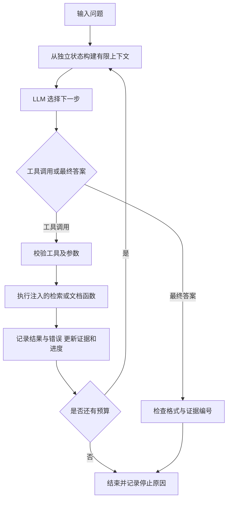

# COMP5423 1.2 Search Agent 独立实现

本组件实现你负责的 1.2：Basic Tool-Using Agent、Iterative Agent Loop 和 Context Management。它不要求同学先完成 1.1，也不需要安装向量模型、建立索引或运行网页界面。

已接入本仓库的 1.1 检索。先阅读 [接入与运行说明](PEER_INTEGRATION.md)，其中包含真实 BM25、DeepSeek 联调记录与可直接运行的步骤。

**运行环境：Python 3.11+，只使用标准库。**

## 已实现

| 要求 | 实现 |
|---|---|
| Basic Tool-Using Agent | LLM 选择工具、生成 JSON 参数；程序执行；结果回传；最终输出简短答案及证据编号 |
| Feature A：迭代 | 每轮重新决策，可利用上轮候选名称继续查证，或在空结果后改写查询；具备轮次/调用/token 预算和停止状态 |
| Feature B：上下文 | 独立问题状态保存查询、已访问文档、候选、子问题、证据；证据去重、受控片段选择、完整工具轮次裁剪；原始轨迹单独完整保留 |
| 可复查运行 | 完整请求、响应、工具参数/结果、状态更新、最终答案及真实 API 用量 |
| 组内对接 | 支持 `search(query, top_k)`；可选文档打开与查词；未提供的工具不注册；技能对接保持可选 |

`agent.py` 是唯一解题循环。离线测试和真实 API 测试都调用它，不维护另一套演示逻辑。检索内容只作为证据，基础提示明确忽略其中的操作指令。



## 文件

```text
search_agent/
  agent.py             配置、主循环、工具调度、证据与上下文管理
  llm.py               DeepSeek / OpenAI-compatible HTTP 适配器
  ports.py             1.1 函数适配与返回格式检查
  agent12.py           独立运行入口与 create_agent 接口
  fixtures_agent12.py  明确标注的合成文档与离线 mock
  config.py            本地 .env / 环境变量配置
  skills.py            可选的 1.3 技能加载连接，1.2 默认不启用
tests/test_agent12.py   独立验收测试
```

## 不需要 API 的独立验收

在本仓库 `agent12/` 目录运行：

```powershell
python -m unittest discover -s tests -p test_agent12.py -v
python -m search_agent.agent12 --offline --scenario multi-hop
python -m search_agent.agent12 --offline --scenario recovery
python -m search_agent.agent12 --offline --scenario context --context-chars 6000
```

- multi-hop：先查到候选，再用观察到的人名查任职机构与奖项。
- recovery：首次返回空结果，下一轮改写查询。
- context：工具返回 12,000 字符原文；模型请求保持在 6,000 字符目标内，完整原文仍留在证据与日志中。

离线场景中的决策者是 mock，不是大模型，API token 为0，不能用来报告课程模型准确率。它们用于验证程序控制与接口。

## 真实 DeepSeek 开发测试

已通过真实 DeepSeek API 联调。运行者在 `agent12/` 目录复制 `.env.example` 为 `.env`，并在本地填写自己的服务商配置；密钥不进入源码或轨迹。

当前账户开发配置：

```dotenv
LLM_API_KEY=在本地填写自己的密钥
LLM_BASE_URL=https://api.deepseek.com
LLM_MODEL=deepseek-flash
```

运行：

```powershell
python -m search_agent.agent12 --fixture-backend --development-model
```

此命令使用真实模型 API 和合成夹具，不加载检索索引。通过真实 1.1 检索运行请使用 [接入说明](PEER_INTEGRATION.md) 中的 `--peer-project` 入口。`--development-model` 显式允许当前配置模型，并标记 `development_only=true`；不改变正式课程模型的默认要求。课程指定原 V4-Flash，当前官方 Flash 版本差异需在正式实验前处理，不能把开发测试写成指定主模型的最终结果。

真实运行记录保存在 `outputs/agent12/`；独立包的 `verification/` 保留三次经过检查的真实调用记录。`summary.json` 列出实际请求、工具次数与 API token，不是官方测试集准确率。

## 和 1.1 同学对接

完整字段与接入方式见 [INTERFACE.md](INTERFACE.md)。

```python
from search_agent.agent12 import create_agent
from search_agent.config import load_config

# search 由 1.1 同学实现；只需要 query 和 top_k。
agent = create_agent(search, config=load_config(enable_skills=False, require_evidence=True))
result = agent.run("问题", question_id="q001")
```

也可直接注入检索函数。没有文档读取工具时只注册 search；有辅助工具时一并注入。BM25、向量与融合都由检索层内部处理，对 Agent 只提供一个检索入口。

## 状态、上下文和日志

每次请求包括基础指令、结构化当前状态、选中的原文片段及近期完整工具轮次。状态包含：

- 原始问题与查询记录；
- 已访问文档、候选答案、活动子问题及未解决条件；
- 独立证据条目与来源；
- 剩余轮次、工具调用和 API token 预算。

去重按文档、来源位置与原文摘要处理，同文档不同片段分别保留。上下文管理先将长工具原文压缩成标明范围的前缀，保留 assistant/tool 配对，再按完整轮次裁剪较早历史；不把模型总结当作原文。压缩与裁剪只影响下一次请求，不删除完整证据和原始日志。

最终 `state` 是结构化状态快照，`trajectory` 是完整时间顺序事件，两者分开。证据条目的 `verified=false` 表示观测不等于客观核验；模型选择的支持证据由 `supporting_evidence` 单独标识。

## 异常与预算

- 无检索结果、工具异常、参数格式错误：作为工具反馈交回模型，允许后续动作恢复。
- 暂时性 API 故障：有限重试，每次请求/响应分别记录。
- 错误最终 JSON、虚构证据编号：给模型一次修正机会，仍错误则明确失败。
- 达到轮次、调用或实际用量预算：停止继续工具执行或模型调用。
- token 预算根据 API 已返回用量判断，最后一次请求可能因为输入成本而超过剩余额度；结果始终记录实际值。
- API 不返回用量时不编造统计；模型身份未确认或不匹配时明确标记。

## 可以写进报告的描述

系统通过统一工具接口接入检索层，以结果驱动的循环完成搜索、阅读和验证。Agent 在原始消息历史之外维护查询、文档、候选与证据状态，并通过去重、长原文压缩和完整工具轮次裁剪控制上下文。开发阶段已接入同学的真实 BM25，使用当前 DeepSeek Flash API 和合成文档完成多跳、空结果恢复、多片段引用及上下文验证。正式课程模型和全量课程语料的评测尚待对应部署与索引提供。

不要把这一组件的测试数量、合成案例答案或开发模型结果写成全项目得分或测试集准确率。
