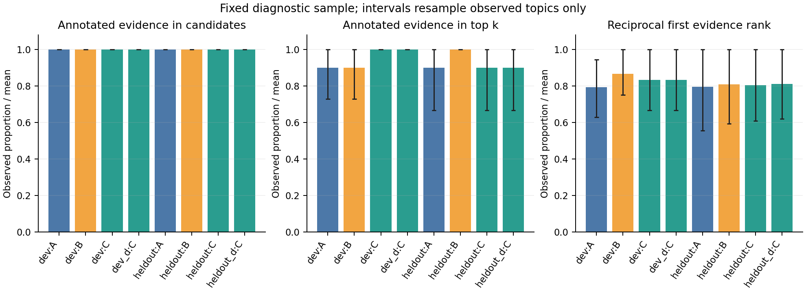
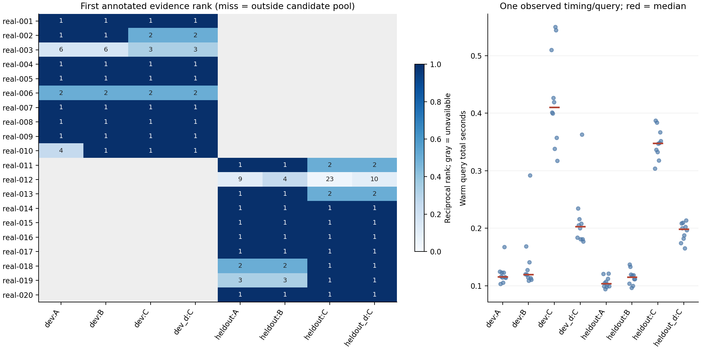
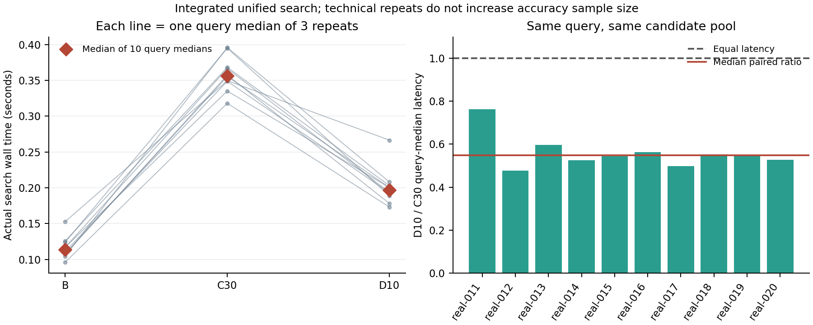

# local-rerank / Round 2 / round-review / 2026-11-11

## 1. 执行结论

已完成可关闭的本地 Cross-Encoder（同时读取问题和候选原文、为两者相关性打分的模型）重排、真实三路检索对照、第二轮单因素优化和真实 OpenRouter 小规模配对。**当前建议组员先使用 B：每路取 50 个候选、保留 RRF 排序、关闭重排。** 这是本次小样本的暂定工程选择：保留集上 B 命中 10/10 个标注证据，C30 与 D10 均为 9/10，且 B 更快。它不是全量语料上的最优性结论。

第一轮 C30 在开发集把证据命中从 B 的 9/10 提高到 10/10，但耗时增加，首证据平均倒数排名下降。第二轮依据实际评分耗时，将重排深度由 30 降为 10；D10 在未用于选择的 10 题上与 C30 命中数相同，统一搜索入口的预热后中位耗时由 0.356493 秒降至 0.196910 秒。因此 **D10 保留为需要重排时的可选省时配置**，不提升为默认设置。仓库默认仍为 A 的原始候选深度，重排关闭。

端到端的主要阻碍已转为 Agent 最终输出：5 题、B/C 共 10 次尝试中，B 为 0/5 normalized EM，C 为 1/5；9 次在拿到标注证据后反复发生 JSON 或引用坐标校验错误，最后触及 token 预算。本轮未修改 Agent 核心，也未追加 D 的付费试验。

## 2. 实验身份与决策背景

起点为远端 `main` 的 `7c4efa4b0acb6b8dc177165985a25f33c1324e9a`，功能分支为 `feat/rag-rerank-evaluation`。任务描述的桌面检出路径在本机不存在，因此复用现有干净检出、保留原环境和历史。实际本地位置记在忽略目录的运行清单中。

该基线已按 `(doc_id, chunk_id)` 融合片段；默认 hybrid 每路深度为 `min(top_k * 3, 60)`，`top_k=5` 时为 15，RRF 参数为 60。RRF（倒数排名融合）依据各路名次合并，不相加 BM25 与向量原始分数。冻结源码、配置、实际 SQLite 查询输出和 50 项基线测试位于 `outputs/rerank-eval/baseline/`。

范围限定为检索、排序、诊断和实验入口：沿用原 900 字符分块、150 字符重叠、embedding 模型及索引格式；未改 Agent、Skills、切块方法或既有三个后端函数签名。四个排序运行使用同一源码摘要：

```text
e3e98c6c05e2cb4e235f07ae0b43a06b6c8b643950bc9528d8e6f07dce255588
```

运行时 Git HEAD 仍为上述基线，新增实现尚在工作区；该摘要覆盖 `src/**/*.py` 与排序评估入口，防止把基线 SHA 误当作唯一执行代码标识。API、统一计时入口有各自的源码摘要算法，不能直接比较不同入口的摘要字符串。最终提交包含这些运行所用实现及报告；具体 Git 提交以分支交付记录为准。

## 3. 实现、数据与评估协议

### 接入与分数约定

`src/rag_agent/retrieval/__init__.py` 的 `SearchService` 在 hybrid 的完整 RRF 池之后、最终 `top_k` 截取之前调用 `retrieval/rerank.py`。CLI、仓库 Agent 和 `rag_agent.peer_backend:create_backend` 共用它；本地内部三路调用仍只对应 Agent 发出的一次 `search`。

配置含 `candidate_depth`、`rerank_enabled`、`rerank_depth`、`rerank_batch_size`、模型/revision/设备、总 token 上限、窗口上限及错误策略。默认 `candidate_depth: null`、`rerank_enabled: false`，关闭状态不构造或载入重排模型，结果、次序和 RRF 分数保持兼容。单路公开检索行为不变，重排只作用于 hybrid。

有效评分数为 `min(候选数, max(rerank_depth, top_k))`；空池直接返回空列表。已评分前缀按模型 logit 降序，等分保持原 RRF 次序，未评分尾部按原次序接后。开启后的公共 `score=1/最终名次`，只表达最终顺序；原 RRF 分数、RRF 名次、原始模型分数、窗口与状态分别保留在 metadata/diagnostics，避免混用两种数值尺度。默认模型错误显式失败；只有配置 `rerank_on_error: rrf` 才降级，并记录 `fallback_rrf`，评估不将其计作重排成功。

按 tokenizer 实测 query、passage 和特殊 token 的**合计**长度，上限 512。超长 passage 使用连续原文窗口，默认最多 4 窗，保留首尾；上限为 1 时选择尾窗，超上限省略的中间窗有计数。每窗重新验证实际 pair 长度，片段得分取窗口最大 logit。query 不剩 passage 预算时显式报错。返回仍是完整原候选，`chunk_id/offset/text` 不变，评分窗口只在诊断中保留绝对坐标。因此始终满足 `document.text[start:end] == snippet`。真实实验没有省略窗口；另用真实模型的合成长输入探针验证尾部、窗口上限及超长 query 错误。

### 固定版本与范围

| 项目 | 实际值 |
|---|---|
| 语料 | `Tevatron/browsecomp-plus-corpus`，train，revision `b27b02bc3e45511b8b82a13e6f90ce761df726f6` |
| 范围 | 固定次序前 100 文档，排除 3 篇超过 100,000 字符的完整文档；最终 97 文档、1,069 原始片段 |
| 内容指纹 | `adc0e479d11bd650bee7c7aff071cdffdd9ba8f98c7a342e3f8fb5394266078f` |
| 索引 | `data/rerank-eval/bounded.sqlite`；`indexes/rerank-eval-bounded`；BM25 + E5 1,072 向量 + Qwen 1,070 向量，沿用 format 1 |
| E5 | `intfloat/e5-small-v2`，revision `ffb93f3bd4047442299a41ebb6fa998a38507c52` |
| Qwen | `Qwen/Qwen3-Embedding-0.6B`，revision `97b0c614be4d77ee51c0cef4e5f07c00f9eb65b3` |
| 重排 | `cross-encoder/ms-marco-MiniLM-L6-v2`，模型及 tokenizer revision `233902d25c440f23af6f7d6e94d2946bac0bee0a` |
| 环境 | macOS arm64，Python 3.12.14，PyTorch 2.9.1，Transformers 4.57.3，NumPy 2.3.5；CPU，embedding batch 4，rerank batch 8 |

模型用途、原始 logit 用法和 512-token tokenizer 限制核对自[官方模型说明](https://huggingface.co/cross-encoder/ms-marco-MiniLM-L6-v2)及[tokenizer 配置](https://huggingface.co/cross-encoder/ms-marco-MiniLM-L6-v2/blob/main/tokenizer_config.json)；语料来源为[官方数据页](https://huggingface.co/datasets/Tevatron/browsecomp-plus-corpus)。模型与 tokenizer 使用同一不可变 revision。

首次审计可用磁盘约 254 GiB。已有真实索引仅覆盖 5 文档的 BM25；既有两路向量索引是 3 篇合成文档，因此新建独立真实索引。先测小批量吞吐，再运行一题完整 pilot，之后扩到两轮。E5 pilot 18 子片段编码 0.344 秒，Qwen pilot 16 子片段 3.765 秒；完整索引构建约 BM25 0.016 秒、E5 15.492 秒、Qwen 202.127 秒，复用已有 embedding 权重缓存。Qwen 构建进程 RSS 峰值约 3.75 GiB。重排权重首次下载 48.511 秒；独立真实模型 smoke 首次加载 2.578 秒；首轮全链路预热 4.638 秒。它们均不计入预热后查询对照。RSS 是进程高水位，不是单个模型增量内存。

### 样本、标签与对照

20 道基于真实原文人工编写的事实诊断题，在看排序结果前冻结；不是官方课程验证题。`real-001`–`real-010` 为开发集（8 个主题），`real-011`–`real-020` 为保留集（9 个主题），问题 ID 和标注来源文档不重叠。每题保存独立的答案、充分证据字符范围与文本摘要。排序入口只收到 `id/question`；答案和范围由排名生成后的评估函数读取。原文、题目、标注和完整轨迹不进入 Git。

| 组别 | 每路候选数 | 重排深度 | 配置 |
|---|---:|---:|---|
| A 原始基线 | 15（top_k=5） | 关闭 | `configs/rerank-eval-a.yaml` |
| B 扩池 | 50 | 关闭 | `configs/rerank-eval-b.yaml` |
| C 同池重排 | 与 B 完全同一 RRF 快照 | 30 | `configs/rerank-eval-c.yaml` |
| D 第二轮 | 与 C 完全同一 RRF 快照 | 10 | `configs/rerank-eval-d.yaml` |

固定 `top_k=5`。主指标是单个返回片段**完整包含**标注充分证据的 Hit@5；首证据 MRR 为首个此类片段名次的倒数。跨块的零碎覆盖不拼接成命中；标注本身须可被某原始块完整容纳。文档级命中独立报告，不能代替片段证据命中。标签为部分标注，未标注片段是“未知相关性”，而非负例。每轮记录语料覆盖、候选覆盖、最终命中、每路排名、RRF 与重排分数、配置/输入摘要、模型版本、延迟和状态；失败重跑保留旧尝试。

## 4. 两轮实测与真实 API

### 固定查询检索

| 样本 | A 证据 Hit@5 / MRR | B | C30 | D10 |
|---|---|---|---|---|
| 开发 10 题 | 9/10 / 0.7917 | 9/10 / 0.8667 | 10/10 / 0.8333 | 10/10 / 0.8333 |
| 保留 10 题 | 9/10 / 0.7944 | 10/10 / 0.8083 | 9/10 / 0.8043 | 9/10 / 0.8100 |

各组全部 20 题的证据已在候选池，文档 Hit@5 均为 20/20；本次差异是片段排序，不是语料或候选漏召回。每次 B 三路均取 50 条，融合池为 68–126 个不同片段。全部排序运行成功，无模型降级、无无效标签。

第一轮：开发集 B−A 的改善/持平/退化为 **0/10/0**，C−B 为 **1/9/0**；后者 MRR 下降 0.0333，说明“更多题进入 top5”和“首证据更靠前”并不相同。第二轮依据平均模型评分 0.271 秒、窗口准备 0.013 秒的剖析，选择只减少评分候选数。决策文件在保留集运行前保存；开发集 D−C 为 **0/10/0** 后才复核保留集。

保留集 B−A 为 **1/9/0**，C−B 为 **0/9/1**，D−C 为 **0/10/0**。D 没有修复 C 的掉出案例，但减少实际评分量；开发和保留分别由 C 的 301/300 个评分窗减少至 D 的 100/100 个。D 与 C 的完整 top5 只有开发 8/10、保留 7/10 完全相同，不能写成“所有结果相同”。

### 统一入口的直接计时

为消除回放总耗时只属组合估计的限制，另经实际 `SearchService.search` 对同一保留集做一次同进程基准：所有模型常驻，5 个 CPU 线程，每题轮换 B/C/D 次序，3 次技术重复后取题内中位数，再对 10 题取中位数。每次均核对候选池和最终 ID 与冻结实验一致。

| 组别 | 完整 search 中位秒数 | 重排部分中位秒数 |
|---|---:|---:|
| B | 0.113804 | 0 |
| C30 | 0.356493 | 0.244513 |
| D10 | 0.196910 | 0.081369 |

D−C 的逐题中位耗时差中位数为 **−0.160604 秒**，10/10 题更快；逐题比值中位数为 0.5476。D 仍比 B 慢，逐题差中位数 +0.079780 秒。此处样本量是 **10 道题，不是 30 个独立样本**。进程 RSS 峰值 2,793,046,016 bytes（约 2.60 GiB）。两轮原始回放计时继续保留，但性能推荐以这次直接完整调用为依据。

### 原版 DeepSeek-V4-Flash 小规模配对

使用任务规定的 OpenRouter `deepseek/deepseek-v4-flash-0731`，两端同 Agent、模型、预算与语料，先一对再四对，共 `real-001`–`real-005` 五题、10 个题目×配置尝试。微信临时目录中的原文件受到操作系统读取限制，实际使用作业目录中同名 `.env.openrouter-smoke`；其 endpoint/model 与任务规定一致，未声称两份未能共同读取的文件逐字相同。通过 `load_dotenv(..., override=True)` 只在运行进程加载。密钥不进入配置序列化、报告、日志或 Git。

| 组别 | 尝试 / 完成 | normalized EM | 实际 API tokens | Agent 发出工具次数 | 停止时阻断的工具事件 |
|---|---:|---:|---:|---:|---:|
| B | 5 / 0 | 0/5 | 160,294 | 25 | 3 |
| C30 | 5 / 1 | 1/5 | 157,066 | 18 | 2 |
| 合计 | 10 / 1 | 1/10 | 317,360 | 43 | 5 |

74 次 HTTP 响应均为 200，返回 model ID 均匹配；没有传输失败或缺失 usage。token 来自实际 `usage.total_tokens`，43 次工具计数对应 Agent 已发出的实际事件，其中 5 次因停止而未执行，不能称为 43 次成功工具执行。共 5 个双端尝试且用量完整的配对，**双端都完成的配对为 0**。失败按原预测记 EM=0，没有用人工解释替换输出。

9 次失败均为最终 `token_budget`；轨迹共记录 29 次最终答案校验失败，其中 16 次 JSON 无效、13 次文本或字符 offset 不匹配。标注证据已出现在实际送给 Agent 的搜索 top5 中，支持将这些失败归为证据送达后的下游输出问题；不能据此证明模型确实正确使用了证据。各次名义 30,000-token 预算在收到当前响应后检查，因此可能超出阈值，报告保留实际账单用量。未修改此既有 Agent 行为。

本 API 对照受大量未完成输出支配，不能把 C 的 1/5 对 0/5 作为稳定回答质量提升证据。D 未做 API 对照。检索运行与付费调用依次进行，避免这项任务的模型作业互相并发争用；未监控系统全部其他后台负载。

## 5. 统计验证与独立复查

[严格分析](rerank-analysis/analysis-report.md)、[统计附录](rerank-analysis/stats-appendix.md)保留全部对照、题目级效应及 mean/SD/范围。按题目 ID 配对，不把片段、回放副本或技术重复扩大成样本量。开发/保留分别只有 8/9 个主题；5000 次主题组重抽样（seed 20261111）仅描述已观察主题构成的敏感性，95% 区间不是抽样总体的置信区间。人工非随机选题且没有独立重复实验，因此没有执行总体显著性检验或宣称显著胜出；全命中产生退化区间也不证明总体无不确定性。不报告不可靠的 p95/p99。

独立复查已从每路名次重新计算全部 A/B 的 RRF，核对 40 份查询运行记录的候选摘要、稳定重排、原文坐标、标签文本摘要、最终 ID 和指标；验证 C/D 唯一配置变量为重排深度、决策先于保留集、测量查询均无首次加载。40 是含开发回放和保留回放的运行记录数，唯一查询仍为 20。

实现验证包括原基线 **50 项通过**、当前 **65 项通过**，Ruff 与 `pip check` 通过、最低依赖安装后 smoke、真实模型短句/长尾/超长 query smoke，以及安装后的真实三路 factory 搜索、同文档多段、原文尾部和字面查找；无敏感内容的验证摘要见 [validation-summary.json](rerank-analysis/validation-summary.json)。后端 `search/open_document/find_in_document` 签名未改。未找到同僚实际 `search_agent.agent12`，因此联调覆盖止于本仓库及安装后后端；不能声称完成同僚模型上下文验证。

## 6. 图表解读



图 1 用候选命中、最终证据命中与 MRR 分开回答“有没有召回”和“排在哪里”。所有候选覆盖相同，但 C 在开发集救回一题、保留集损失一题；这支持保留可关闭开关，并阻止仅根据开发命中率开启默认重排。误差线仅为主题重抽样条件区间。



图 2 用逐题名次定位退化，并展示原始测量分布。`real-012` 在两种重排深度均掉出 top5，说明仅减评分预算没有消除排序失配。图中回放总耗时为复用召回时间加新重排时间。



图 3 以统一入口的完整调用检验实际系统成本，左侧每条线是一题的三次技术重复中位数，右侧为同题 D/C 比值。10 题均更快，支持 D10 的可选省时用途；它不抵消未修复的证据退化。图的来源、解释边界及复核检查见[图目录](rerank-analysis/figure-catalog.md)，脱敏逐题计时见 [integrated-summary.json](rerank-analysis/integrated-summary.json)。

## 7. 典型案例、负结果与限制

| 案例 | 证据 chunk_id | 名次变化 | 可支持的解释 |
|---|---|---|---|
| 开发改善 `real-003` | `6753:2250:900` | B6 → C3 → D3 | 已召回证据经重排进入 top5 |
| 开发轻度退化 `real-002` | `68484:750:900` | B1 → C2 → D2 | Hit@5 不变，但首证据排名下降 |
| 保留退化 `real-012` | `18690:5250:730` | A9 → B4 → C23 → D10 | 扩池改善 RRF；重排把充分证据压低 |
| 保留持平 `real-014` | `84039:750:900` | B1 → C1 → D1 | 未观察到名次收益 |

`real-012` 的标注范围完整位于评分窗 `[5250, 5980)`，query–passage 合计 256 tokens，logit 为 −5.59348；没有截断或漏窗，故不能把它归因于长度上限。其评分更低的机制仍需更多同类问题检验，当前只确认排序模型与这项证据判据失配。

范围限制：97 篇有长度上限的真实文档，不含全量 100,195 文档索引；20 道自拟事实题与部分证据标签，不代表课程复杂多跳题分布；本样本有意保证证据覆盖，不能估计全量缺失率。未标注候选可能也含有效证据。独立计时只覆盖本机这批查询，技术重复不能推断跨机器稳定性。

仓库 Agent 的原始工具轨迹保留 `chunk_id/offset/text`，但内部 `Evidence` 与压缩上下文仅保存 `doc_id/offset/text/url`；未把它错误描述为始终携带 `chunk_id/start/end`。同文档独立范围仍保留，包含关系的证据会按原逻辑合并。本任务记录此接口后续项，未越界修改 Agent。

## 8. 对原假设的更新

“候选已召回但排名太低”在 `real-003` 得到支持，但“本地重排普遍更好”未获保留集支持。扩大候选深度在 `real-012` 改善了 RRF 名次，即使候选是否命中的二值指标不变，也可能改变各路对同一片段的贡献。

“模型评分是重排的主要成本”获得剖析和直接计时支持；D10 是有效的样本内成本优化，但没有增加保留集命中。当前可复用成果是可关闭排序、同池回放和失败归因，不是宣称已解决课程答题。真实 API 进一步指出，现阶段最终 JSON 和引用坐标正确性比继续扩大排序实验更值得优先处理。

## 9. 决策与下一步

1. 组员接入暂用 `configs/rerank-eval-b.yaml`；它指向本轮小语料。迁移到别的数据范围时必须改用独立 store/index，并保持匹配的 embedding 与分块配置。
2. 保留 C30 作为第一轮可复核对照、D10 作为可选省时重排；仓库默认配置仍关闭重排、使用原候选深度。不依据这 20 题启用全局默认重排。
3. 下一阶段首先由 Agent 负责人修复最终 JSON 格式与引用 offset 的构造/校验往返，保留当前失败轨迹作为回归材料；同时检查压缩上下文是否需要携带 chunk ID。修复后先以未新增费用的保存证据做离线验证，再在另行确定的付费预算内重跑少量同题配对。
4. 后续扩展到官方验证题及更完整语料覆盖，再判断重排对多线索题的收益。当前没有追加全量索引、修改 Agent 核心或扩大付费运行。

## 10. 产物索引与复现

公开可提交内容为代码、配置、合成测试、本报告和 `docs/rerank-analysis/` 中不含题目/原文/密钥的分析汇总，包括 [API 汇总](rerank-analysis/api-summary.json)、[独立审计](rerank-analysis/final-experiment-audit.json)及[第二轮预先决策](rerank-analysis/round2-decision.json)。以下原始目录留在本地忽略区域：

| 产物 | 路径 |
|---|---|
| 冻结输入、ID 清单及标签摘要 | `data/rerank-eval/manifest.json`、`questions.jsonl`、`labels.jsonl` |
| 基线及完整一题 pilot | `outputs/rerank-eval/baseline/`、`pilot/` |
| 首轮开发与 D 开发回放 | `outputs/rerank-eval/round1/`、`depth10-dev/` |
| 第二轮控制与 D 保留回放 | `outputs/rerank-eval/round2-control/`、`round2-depth10/` |
| 第二轮预先决策 | `outputs/rerank-eval/round2-decision.json` |
| 统一 search 直接计时 | `outputs/rerank-eval/latency-integrated/` |
| API 原始记录、汇总与预算账本 | `outputs/rerank-eval/api-pilot/`、`api-main/`、`api-summary.json`、`api-budget.json` |
| 独立复核、真实模型与安装后工厂 | `outputs/rerank-eval/final-experiment-audit.json`、`real-model-smoke.json`、`installed-factory-real.json` |

每个评估目录有 manifest、配置内容/指纹、数据与模型版本、固定样本顺序、候选快照、逐题状态和汇总。输入、配置、索引或相关源码变化会拒绝原地恢复；使用新输出目录，或在相同身份下加 `--rerun-failed` 归档后重试。API 配置指纹与纯检索指纹可能不同，因为 `.env` 覆盖了模型验证备注；应读取对应完整 manifest，不能只按配置文件名或假定指纹相同来配对。

### 最低依赖：无需密钥或模型权重

从仓库根目录执行。普通安装用于确保 CLI 与工厂载入最新代码；本机不依赖 editable 安装。

```bash
python3.12 -m venv .venv
source .venv/bin/activate
python -m pip install '.[dev]'
python scripts/smoke_rerank.py --output outputs/rerank-smoke
python -m pytest
python -m ruff check src scripts tests
```

该 smoke 使用真实 SQLite、factory、统一搜索与重排调度；E5/Qwen 排名、tokenizer、打分为明确标记的替身，验证无 PyTorch/Transformers 导入及无网络/API，不能证明模型质量。另在新建的独立虚拟环境中仅执行 `python -m pip install .` 安装基础包，确认 PyTorch/Transformers 均不存在后再次通过，日志保存在本地 `minimum-clean-*` 记录中；最低依赖路线并非仅凭已装齐检索依赖的开发环境推断。

### 准备同一真实范围与私有标注

```bash
python -m pip install '.[retrieval,dev,analysis]'
export OMP_NUM_THREADS=5 MKL_NUM_THREADS=5 TOKENIZERS_PARALLELISM=false
USE_TORCH=0 python scripts/prepare_rerank_eval.py --prepare-corpus \
  --store data/rerank-eval/documents.sqlite --limit 100 \
  --revision b27b02bc3e45511b8b82a13e6f90ce761df726f6
python scripts/prepare_rerank_eval.py \
  --bounded-from data/rerank-eval/documents.sqlite \
  --store data/rerank-eval/bounded.sqlite --max-doc-chars 100000 \
  --annotations data/rerank-eval/annotations-source.jsonl --output data/rerank-eval
rag-agent index --config configs/rerank-eval-b.yaml --methods sparse encoder instruction
python scripts/smoke_rerank_model.py --config configs/rerank-eval-d.yaml \
  --output outputs/rerank-repro/real-model-smoke.json
```

`annotations-source.jsonl` 是这次冻结的私有人工标注，未放入 Git；组员须取得授权的原文件才能复现同一 20 题。仅克隆仓库可以跑最低依赖测试及重新下载同一语料范围，但不能凭空恢复这份未发布题目/标注。已有完全匹配的 store/index 可直接复用；模型缓存、下载时间和约数 GiB 内存另计。

### 两轮同池复现

```bash
python scripts/evaluate_rerank.py --config configs/rerank-eval-c.yaml \
  --questions data/rerank-eval/questions.jsonl --labels data/rerank-eval/labels.jsonl \
  --output outputs/rerank-repro/round1 --split dev --candidate-depth 50 --rerank-depth 30
python scripts/evaluate_rerank.py --config configs/rerank-eval-d.yaml \
  --questions data/rerank-eval/questions.jsonl --labels data/rerank-eval/labels.jsonl \
  --output outputs/rerank-repro/depth10-dev --split dev --candidate-depth 50 --rerank-depth 10 \
  --replay outputs/rerank-repro/round1
python scripts/evaluate_rerank.py --config configs/rerank-eval-c.yaml \
  --questions data/rerank-eval/questions.jsonl --labels data/rerank-eval/labels.jsonl \
  --output outputs/rerank-repro/round2-control --split heldout --candidate-depth 50 --rerank-depth 30
python scripts/evaluate_rerank.py --config configs/rerank-eval-d.yaml \
  --questions data/rerank-eval/questions.jsonl --labels data/rerank-eval/labels.jsonl \
  --output outputs/rerank-repro/round2-depth10 --split heldout --candidate-depth 50 --rerank-depth 10 \
  --replay outputs/rerank-repro/round2-control
python scripts/benchmark_rerank.py \
  --configs configs/rerank-eval-b.yaml configs/rerank-eval-c.yaml configs/rerank-eval-d.yaml \
  --questions data/rerank-eval/questions-heldout.jsonl --repeats 3 --threads 5 \
  --snapshots outputs/rerank-repro/round2-control outputs/rerank-repro/round2-control outputs/rerank-repro/round2-depth10 \
  --output outputs/rerank-repro/latency-integrated
python scripts/summarize_rerank.py \
  --runs dev=outputs/rerank-repro/round1 dev_d=outputs/rerank-repro/depth10-dev \
         heldout=outputs/rerank-repro/round2-control heldout_d=outputs/rerank-repro/round2-depth10 \
  --labels data/rerank-eval/labels.jsonl --output outputs/rerank-repro/analysis \
  --compare dev:C=dev_d:C --compare heldout:C=heldout_d:C \
  --latency outputs/rerank-repro/latency-integrated
```

### 真实 API：独立预算账本与显式 env 加载

将授权的本地配置放在仓库根目录 `.env.openrouter-smoke` 后使用以下入口。下列命令会发生付费调用，只供后续获授权复现；本次已完成的 10 次尝试不需要再次运行。保留同一个账本，**不得通过换账本绕开本任务上限**。

```bash
git check-ignore .env .env.openrouter-smoke
python scripts/run_rerank_agent.py \
  --configs configs/rerank-eval-b.yaml configs/rerank-eval-c.yaml \
  --questions data/rerank-eval/questions.jsonl --limit 5 \
  --env-file .env.openrouter-smoke --ledger outputs/rerank-eval/api-budget.json \
  --output outputs/rerank-repro/api
python scripts/summarize_rerank_agent.py --runs outputs/rerank-repro/api \
  --labels data/rerank-eval/labels.jsonl --output outputs/rerank-repro/api-summary.json
```

runner 在付费请求前预留尝试，最多 20 次题目×配置尝试、10 个唯一题目 ID；中断、失败或新目录中的重新尝试仍占账本名额，已有结果可跳过。它不限制底层 HTTP 响应次数为 20；同一 Agent 尝试可能有多轮响应，均累计实际 usage。此次用了 10 次尝试、5 个唯一 ID，未消耗剩余名额来掩盖失败。

单配置标准 CLI 的等价 env 加载方式如下；它不带上述共享总预算账本，应优先使用配对 runner 管理本任务预算。

```bash
python -m pip install 'python-dotenv[cli]==1.2.1'
head -n 1 data/rerank-eval/questions.jsonl > data/rerank-eval/questions-pilot.jsonl
dotenv -f .env.openrouter-smoke run --override -- \
  rag-agent predict --config configs/rerank-eval-b.yaml \
  --input data/rerank-eval/questions-pilot.jsonl --output outputs/rerank-repro/single-prediction.jsonl
```

未绑定或写回 Obsidian。接续工作应优先修复已保存的 Agent 最终输出失败，再用新的独立问题验证检索推荐是否成立。
