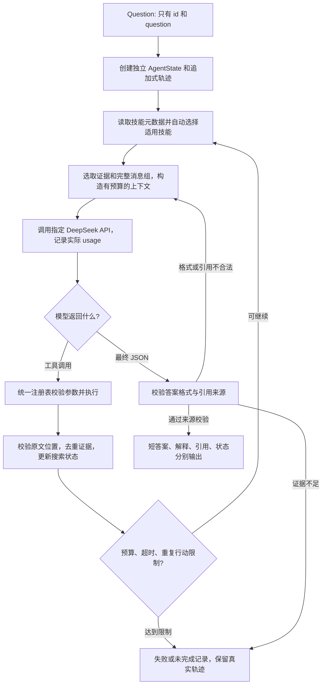

# Agent 设计思路

本项目的 Agent 是一个“根据查到的证据决定下一步”的问答程序。它通过 API 调用课程指定的 DeepSeek-V4-Flash，使用统一工具查询固定文档集合；每次拿到结果后，可以继续查找、打开原文、加载处理步骤，或结束并给出简短答案。CLI 批处理与网页共用这一套实现。

可以把它理解为查阅图书馆资料的人：检索器相当于目录，工具相当于查目录、翻书和查找词句的方法，Agent 负责决定下一步。这个类比只说明分工；程序并没有人类式理解的保证，因此原文位置、调用记录和最终答案还要分别检查。

## 1. 实际结构与设计取舍

```text
src/rag_agent/
├── schemas.py、config.py       # 共享数据协议与配置
├── runtime.py                 # 网页和 CLI 共用的运行组件工厂
├── data/、retrieval/           # 固定语料、三类检索与融合
├── tools/registry.py          # 工具 schema、分发、参数及输出校验
├── llm/provider.py            # API 接入、重试、usage 与离线示范
├── agent/loop.py、context.py  # 迭代控制、状态、模型上下文
├── skills/runtime.py          # 元数据发现、自动选择、按需读取正文
├── evaluation/               # 批量落盘、格式验收、独立答案评测
└── cli.py、web_app.py         # 命令行与 Streamlit 网页
skills/*/SKILL.md              # 两个本项目原创的过程说明
configs/                      # 完整配置、演示与对比实验配置
```

最终结构保留“数据、检索、工具、模型、Agent、评测”的边界，并通过 `runtime.py` 和 `run_question()` 共享业务流程。这样，网页修改不会产生另一套问答算法；更换检索实现，也不必改动 Agent 的调用协议。`schemas.py` 定义问题、证据、状态及预测记录，避免各组员分别解释同一字段。

## 2. 从问题到答案的实际流程



例如，合成测试问题询问“Lumen Observatory 设计者就读的大学位于哪里”。第一次检索找到设计者 Mira Sol，以及她就读的 Cedar University；下一次检索使用刚查到的大学名称，得到 Northport。后一次查询的实体来自前一次结果。确定性测试和离线网页演示已覆盖这条依赖关系；实际 DeepSeek 是否选择同样的步骤，还需要真实 API 运行验证。

正式入口是 `agent/loop.py` 中的 `run_question(question, settings, ...)`。它接受的 `Question` 不包含参考答案；验证集标签只由独立评测模块读取。

## 3. 模型接入与四种工具

`llm/provider.py` 集中处理 HTTPS 请求、超时、有限次重试和 API 用量。业务代码不直接接触 API key。key 从本地环境或 `.env` 读取；写入轨迹前还会进行凭据脱敏。

截至 2026-11-10，项目核对了 OpenRouter 模型目录中的 `deepseek/deepseek-v4-flash-0731`，并将其写入 `configs/openrouter.yaml`。这是提供商目录与模型映射的核对，**尚未使用真实 key 完成一次推理验证**。当前 DeepSeek 官方服务的旧 V4-Flash 名称存在路由到 V4.1 的变化，因此配置检查阻止将该旧入口当作课程原始模型使用；详见 `docs/provider.md`。

OpenRouter 接入采用同一 backbone 的关闭 thinking 基线：adapter 显式发送 `reasoning: {enabled: false, exclude: true}`。模型目录允许关闭 reasoning；此设置避免默认开启的 thinking 产生额外的跨轮回传要求，也不请求隐藏思维链。其他兼容服务不附加此服务专用字段。字段已通过本地模拟传输测试，真实服务行为仍待验证。

默认完整配置向 Agent 暴露以下 **4 种**实际工具：

| 工具 | 负责的工作 | 返回内容 |
|---|---|---|
| `search` | 在固定语料检索；唯一检索工具 | 文档 ID、分数、片段、URL、偏移及检索信息 |
| `open_document` | 按字符偏移分页读取一篇文档 | 原文、当前偏移、下一页位置、文档长度 |
| `find_in_document` | 在指定文档中寻找字面词句 | 命中位置及附近的有限长度原文 |
| `load_skill` | 运行时读取一个已发现的技能正文 | 技能名称与完整过程说明 |

输入、输出和分发共同来自 `tools/registry.py`。参数错误、文档不存在、越界和重复加载会返回结构化错误，让 Agent 有机会调整行动。`open_document` 每次最多返回 2,400 个 Unicode 字符；字符偏移按 Python 字符串位置计算，并非字节位置。来源 URL 只用于溯源，没有浏览网页工具。

完整 hybrid 配置允许模型选择检索方法；单方法对比配置则同时在工具 schema 和分发器限制对应方法，防止一次“encoder 实验”悄悄混入其他检索器。关闭 skills 的消融实验只暴露前三种工具。

## 4. 状态、模型上下文与审计轨迹

这三者承担不同职责：

| 数据 | 内容与用途 | 是否裁剪 |
|---|---|---|
| `AgentState` | 问题、访问文档、原文证据、活动查询、候选答案、已选技能、计数和终止状态 | 证据去重；保留独立结构 |
| 每轮模型上下文 | 当前问题、运行时技能、相关状态证据、最近完整工具会话 | 按字符预算选取与删除旧消息组 |
| `trajectory` | 实际请求、响应、工具参数与结果、状态、技能、错误及停止事件 | 追加式保存，不能因上下文裁剪而删除 |

`context.py` 先为问题和已加载技能保留空间，再按与问题词汇的重合程度选择证据，最后从最近消息开始保留能放下的完整消息组。这里的字符预算是一种工程上的长度控制，**不是正式 API token 数量**。一次 assistant 工具调用及其所有 tool 结果作为一个整体保留或删除，避免出现“留下结果、删掉对应调用”的非法会话。

证据进入状态前，要和本地文档的 `text[offset:offset+len(text)]` 完全匹配。相同或被已有片段覆盖的证据不会重复保存；更大的已读片段可以替换被它完整覆盖的小片段。最终引用还须落在本次实际取得的证据范围内。

这些校验证明“引文来自哪里、是否曾被本次运行取得”，不能自动证明引文在语义上足以支持答案。语义正确性仍依赖模型判断及独立的 normalized EM（规范化后精确匹配）评测，不能把引用来源校验通过等同于回答正确。

## 5. 两个原创 skills 如何影响下一步

Skill 可以理解为“在特定情况使用的操作步骤”。程序启动只读取 `SKILL.md` 的 YAML 元数据，不把全部正文放进固定提示词。

- `multi-clue-decomposition`：多线索问题触发。它要求先找具有区分力的线索，再用实际发现的实体连接下一次查询，逐项核对关系。
- `search-recovery`：空结果、工具错误或重复证据触发。它要求先识别失败原因，再改变查询长度、实体表达或允许的检索方法，并检查是否真正增加了证据。

`SkillCatalog.select()` 根据问题特征和搜索停滞状态自动选择；模型也可以调用 `load_skill`。选中后才从目录读取正文，并把正文加入下一轮模型上下文，因此它会改变后续模型接收到的操作指导。已加载技能不能重复加载；简单问题可以完全不加载技能。

当前路由器是小型确定性规则，便于解释和测试，并非另一个隐藏的模型调用。确定性测试验证两个触发分支、无需技能分支以及延迟读取机制。规则覆盖面和真实模型遵循效果仍需后续验证集实验评估。

## 6. 预算、错误恢复及统计

配置包含最大模型轮数、工具调用数、输出长度、API token 总量、单次请求超时、整体运行时限和重复行动上限。输入 token 在 API 返回前无法准确知道，因此 token 上限是收到真实 usage 后停止的软边界；一次请求可能使累计量超过设定值，轨迹保留实际值，并标记 `token_budget`。

每个退出路径都有 `stop_reason`，例如 `completed`、`insufficient_evidence`、`step_budget`、`tool_budget`、`token_budget`、`timeout`、`missing_usage` 或 `provider_error`。最终 JSON 或引用格式错误可以进入下一轮修复；修复同样计入真实调用与 token。相同工具和参数反复出现则停止，防止循环消耗。

`tool_calls` 统计模型实际发出的每个工具调用，包括失败参数、未知工具、模型触发的技能加载，以及同一响应中因预算而未执行的后续调用。检索工具内部运行三个检索器仍算一次工具调用。自动技能发现和规则选择属于程序内部操作，记录事件但不计为模型工具调用。

`total_tokens` 只累计提供商返回的 `usage.total_tokens`，不把 prompt、completion、cache 或 reasoning 字段再次求和。若重试错误响应仍带可靠 usage，单独的 `api_usage` 事件会保存并累计这部分用量。传输失败或缺失 usage 可能造成账目不完整，这类运行不能作为合格正式预测。返回模型 ID 也必须与已配置的模型 ID 一致。

最终 `answer` 是短字符串；网页解释、引用、状态及完整过程保留在其他字段和轨迹中。离线 DemoProvider 为规则程序，其 token 为 0、运行模式为 demo、正式资格为 false；它的结果不能混入课程正式预测。通过参数注入的 provider（包括 HTTP 测试替身）也一律标记 `injected_provider=true` 并排除正式资格，防止改一个 provider 名称便把脚本测试误记为真实运行。

## 7. 当前验证状态及下一步

当前实现已具备循环、工具、独立状态、上下文预算、运行时 skills、完整轨迹、计数和失效处理。`tests/test_agent.py` 的 **20 个确定性测试案例**已通过，覆盖多步依赖、技能分支、引用校验、上下文配对、失败工具计数、usage 缺失、重试用量、方法限制、预算停止、注入 provider 与畸形工具响应保护，以及 OpenRouter 专用字段的隔离。HTTP adapter 的测试使用 `httpx.MockTransport`，不代表真实模型验证。

真实指定 LLM 的问答、技能遵循、工具返回兼容性与正式 API 费用统计仍待提供 key 后验证；尚无 100 题全量效果或效率结论。下一阶段应先运行一题 live smoke test，检查实际响应 model 和 usage，再进行小批量配置比较，最后才开展全量验证、报告和演示。项目的 `configs/ablation-*.yaml` 提供单次检索、无上下文管理、无 skills 及单检索方法对比入口；它们目前没有预填实验成绩。

运行方式和全部命令以仓库 `README.md` 为准，实际执行证据与未执行项目以 `docs/validation.md` 为准。
