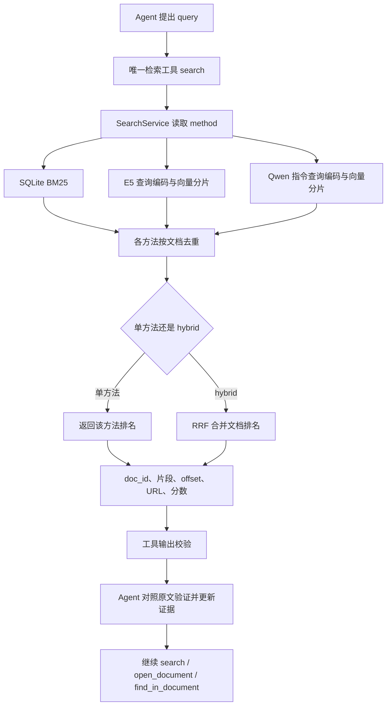

# RAG 设计思路

本文解释当前仓库中已经写出的检索实现，供小组讨论和接续开发。代码、离线测试、真实模型验证、完整课程实验是四个不同层次；最终执行记录见 [`validation.md`](validation.md)。

## 1. 先看系统要解决的具体问题

假设合成测试语料中有两份文档：

- `d1`：Lumen Observatory 的设计者是 Mira Sol；Mira Sol 就读于 Cedar University。
- `d2`：Cedar University 位于 Northport。

用户问：“Lumen Observatory 设计者就读的大学在哪座城市？”只检索原问题一次，可能只能找到 `d1`。系统需要先取出大学名称，再用这个名称查找 `d2`，最后给出短答案 `Northport` 和真实原文位置。这里的名称与文档来自 [`tests/fixtures/corpus.jsonl`](../tests/fixtures/corpus.jsonl)，都是项目自写的虚构测试数据，不是课程题目或实验结果。

RAG（检索增强生成）在本项目中负责“从固定材料中找出可核对的证据”。Agent（能够安排工具调用的控制程序）负责“下一步查什么，以及证据是否足够”。检索层不直接写最终答案，也不读取参考答案。

可以把它类比成实验室查资料：原始文档是资料柜，索引是检索目录，检索器是查目录的方法，Agent 是根据已找到的信息继续查证的人。这个类比只说明职责分工；向量相似度不是人的理解，也不能保证找到的材料足以证明答案。

## 2. 当前整体结构与公共边界

```text
repository/
├── configs/                     默认、demo、服务商及对比实验配置
├── src/rag_agent/
│   ├── schemas.py               Document、Chunk、SearchHit、Evidence 等公共协议
│   ├── config.py / runtime.py   配置校验；CLI 和网页共用的运行对象创建
│   ├── data/                    原始文档、字符分块、固定语料导入
│   ├── retrieval/               三类检索、持久化索引、RRF 融合
│   ├── tools/                   search 与三个支持工具的统一注册表
│   ├── llm/ / agent/            API 适配、迭代、证据与上下文管理
│   ├── skills/                  技能发现、选择、按需读取
│   ├── evaluation/              批量运行、格式校验、答案评测
│   └── cli.py / web_app.py      命令行和 Streamlit 展示入口
├── skills/                      两个原创 SKILL.md 正文
├── tests/                       合成语料和风险测试
├── scripts/                     真实检索 smoke、数据下载与课程打包
└── docs/                        设计、协议、要求映射和验证记录
```

`data/`、`indexes/`、`outputs/` 等运行目录另存数据、索引和结果；这些生成内容不进入源码提交。最终结构保留数据、检索、工具和 Agent 的独立职责，通过 `runtime.py` 让网页和命令行使用同一套实现。组员修改检索方法时，不需要复制一套新的网页或 Agent。

## 3. 从原始文档到可恢复的索引

### 文档适配和存储

[`data/prepare.py`](../src/rag_agent/data/prepare.py) 只从 `Tevatron/browsecomp-plus-corpus` 的 `train` split 流式读取。流式读取是边接收边处理，不先把整个集合装入内存。开始前解析实际数据 commit SHA，即该份数据的版本标识；记录字段、版本、样本限制和实际导入数量。本地已有 JSONL 也可导入，JSONL 表示每行一个 JSON 对象。

[`data/store.py`](../src/rag_agent/data/store.py) 将官方 `docid/text/url` 适配为 `Document(doc_id, text, url)`。`"001"` 始终保持字符串，不能转成数字 `1`。SQLite 是一个存放在本地文件里的数据库；这里分表保存完整文档、片段和导入元信息，按文档 ID 精确读取原文，避免每次查询扫描所有文本文件。

相同 ID、相同内容可重复导入并跳过，用于恢复中断任务；相同 ID、不同内容会报错。导入未结束时标记为不完整，检索和建索引不能把它当作完整语料。内容指纹由实际文档和分块设置计算，索引加载时用它检查是否对应同一份数据。

### 分块与原文位置

默认 `chunk_size=900`、`chunk_overlap=150`，单位是 Python Unicode 字符。第一段从 0 开始，下一段从 750 开始，因此相邻两段共享 150 个字符。重叠有助于保留跨边界的句子，但不等于保证每段语义完整。

每段保存 `doc_id`、`chunk_id`、`offset`、`text`、`url`。`offset` 是从 0 开始的字符位置，片段满足：

```python
original_text[offset : offset + len(text)] == text
```

这里的下标不是 UTF-8 字节位置。这个约定也用于 `open_document`、网页证据和最终引用；组员处理中文时尤其不能混用字节和字符。

Embedding（把文字编码为一串数值，以便比较相似度）模型还有 token 长度限制。Token 是模型分词后的一小段文字，字符数不能准确代替 token 数。因此 [`retrieval/embedding.py`](../src/rag_agent/retrieval/embedding.py) 在编码前使用对应模型的 tokenizer 检查长度；超限片段继续分成有重叠的子片段，并调整原文 offset。过长查询显式报错，供 Agent 改写，不静默丢弃后半段。

## 4. 三类检索分别怎样实现

| 方法 | 实际实现 | 查询与文档处理 | 结果含义 |
|---|---|---|---|
| Sparse，稀疏检索 | SQLite FTS5 的 BM25 | `unicode61 remove_diacritics 2` 分词，不做词干提取；查询按词匹配 | 根据词出现情况和长度估计相关性，适合明确名称和关键词 |
| Encoder dense，编码器向量检索 | `intfloat/e5-small-v2` | 查询前加 `query: `，文档前加 `passage: `；对非填充 token 的输出取均值 | 比较文字向量，能补充词面不同但语义相关的结果 |
| Instruction-aware LLM embedding，带任务指令的大模型向量检索 | `Qwen/Qwen3-Embedding-0.6B` | 查询使用 `Instruct: {instruction}\nQuery:{query}`，文档不加指令；左侧填充后取最后一个真实 token 的输出 | 将“这次应检索哪类材料”的任务描述加入查询编码 |

三类实现分别见 [`sparse.py`](../src/rag_agent/retrieval/sparse.py)、[`embedding.py`](../src/rag_agent/retrieval/embedding.py) 和 [`dense.py`](../src/rag_agent/retrieval/dense.py)。E5 和 Qwen 使用各自的真实模型前向计算，向量不共享；第三类不是给 E5 的查询随意加一句话。

两类向量都做 L2 归一化，即把向量长度统一为 1，再计算点积；此时点积就是余弦相似度，主要比较方向。默认 E5 为 384 维，Qwen 为 1024 维。模型身份、前缀和池化规则来自官方模型卡，依据链接集中在 [`retrieval_sources.md`](retrieval_sources.md)。E5-small-v2 主要面向英文，不能假设它对所有语种同样有效。

SQLite BM25 的原始排序方向是数值越小越好，接口返回时取负号，统一成“分数越大越靠前”。这仍不意味着 BM25 分数可以直接和向量相似度相加。

## 5. 持久化、恢复与资源取舍

Sparse 索引保存在 `index_dir/sparse.sqlite`。向量索引分别保存在 `index_dir/encoder/` 和 `index_dir/instruction/`，每 256 个原始片段形成一个可恢复分片，实际编码按 `batch_size` 分批进行。

每个向量分片由 `.npy` 数值文件和 `.jsonl` 片段信息文件组成。NumPy 的内存映射让程序按需要访问磁盘上的数组；查询时逐分片计算相似度，只保留少量最佳文档候选，不把全部向量及原文复制进内存。

`manifest.json` 是索引说明文件，记录语料指纹、分块方式、模型 ID、版本、维度、池化、归一化、查询 instruction 和分片校验和。程序先解析一次不可变模型版本，再让 tokenizer 和模型权重都使用该版本。恢复构建时检查已完成分片的校验和、形状、行数和片段顺序，跳过已完成编码；未完成分片重新计算。

这里选择了 NumPy 分片精确扫描，而不是 FAISS 等近似向量搜索库，理由是安装依赖更少、结果容易检查、CPU 环境也能运行。代价是每次查询仍要遍历全部向量。**内存受控不代表查询快**；完整语料的建索引时间、磁盘需求和查询延迟仍须测量，后续再决定是否换成近似索引。网页查询只加载已有索引，不触发全量建索引。

## 6. 融合后的证据怎样交给 Agent

每个检索方法先按文档 ID 去重，保留该文档得分最高的命中片段。Hybrid 模式把三份文档排名交给 RRF（倒数排名融合）：一个文档在多个列表中靠前，就得到更多排名分；不同检索器的原始分数不直接相加。默认参数为 `rrf_k=60`。

具体计算中，每个方法为排名为 `rank` 的文档贡献 `1 / (60 + rank)`；`rank` 从 1 开始。参数 60 越大，第一名和后续名次之间的差距越温和。去重后同一方法对同一文档只贡献一次。融合元信息还保留各方法的名次、原始分数和片段位置，便于查错与比较。



[`retrieval/__init__.py`](../src/rag_agent/retrieval/__init__.py) 的 `SearchService.search()` 是检索公共接口。Agent 只看到 [`tools/registry.py`](../src/rag_agent/tools/registry.py) 中一个 `search(query, top_k, method)`，其余可调用工具为 `open_document`、`find_in_document`、`load_skill`，共四种。一次 hybrid 搜索内部运行三个检索器，仍是一次 Agent 工具调用。

工具返回经 schema（字段和类型规则）校验的结构化结果，片段最多返回 1600 个字符；需要更多上下文时通过 `open_document` 分页读取。Agent 把片段与原文位置重新核对后才加入 `Evidence`。这种核对证明“引用确实来自已查看的文本”，不自动证明“引用逻辑上足以回答问题”。`url` 只作来源标识，程序不会抓取 URL 扩充语料。

## 7. 组员怎样运行和接续修改

从仓库根目录运行，先按 README 安装依赖。无需密钥的真实 BM25 流程：

```bash
rag-agent prepare --config configs/demo.yaml --source tests/fixtures/corpus.jsonl
rag-agent index --config configs/demo.yaml --methods sparse
rag-agent search --config configs/demo.yaml --method sparse 'Where is Cedar University located?'
```

安装检索依赖后，显式运行三类真实模型的小样例检查；该命令可能下载两套权重：

```bash
python -m pip install -e '.[retrieval,dev]'
python scripts/smoke_retrieval.py --methods sparse encoder instruction --device cpu
```

正式语料流程使用单独配置和目录：

```bash
rag-agent prepare --config configs/default.yaml --hf --limit 20
rag-agent index --config configs/default.yaml --methods sparse encoder instruction
```

`--limit 20` 只是管线检查，不能称为完整语料实验。改为全量时应为它指定新的 `store_path` 和 `index_dir`，再去掉 `--limit`；已有样本存储的来源标识包含限制值，程序会拒绝混用。

建议的数据/检索模块协作边界是维护 `DocumentStore`、`SearchHit` 和 `SearchService`；Agent/工具组员依赖这些接口，不直接解析索引文件。网页组员通过共用运行入口展示结果；评测组员只读取预测和独立参考答案。这里是接口建议，不代表实际组员身份、贡献比例或已经确认的分工。

## 8. 已验证范围与后续工作

| 范围 | 当前证据 |
|---|---|
| 9 个检索风险测试 | 已运行通过；覆盖 ID、offset、真实 BM25 持久化/去重、融合、分片恢复、损坏与配置检查、多分片文档汇聚 |
| 合成语料上的 BM25 检索 | 已真实运行，不依赖 API 或神经模型 |
| 向量索引协议与恢复 | 显式测试替身验证；manifest 标记测试来源，真实入口拒绝当作模型索引 |
| E5 与 Qwen 的真实模型 smoke | 已在 CPU 上用 3 篇合成文档完成真实编码、持久化、重新加载和查询；E5 384 维、Qwen3 1024 维，详见 [`validation.md`](validation.md) |
| 100,195 文档全量索引、100 题表现 | 尚未完成；没有课程 EM、排名或效率结论 |

下一阶段先完成指定 LLM 与已验证检索器的小样例闭环，再测量全量资源和检索速度；随后通过现有单方法/融合配置比较效果，调整 chunk 大小、top-k 和 instruction。任何性能表都应来自保存下来的实际运行记录，不能把合成测试表现当作课程表现。
