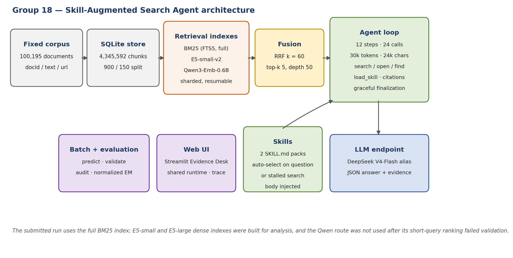
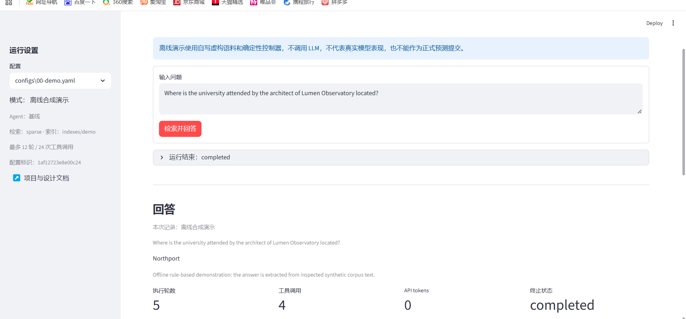
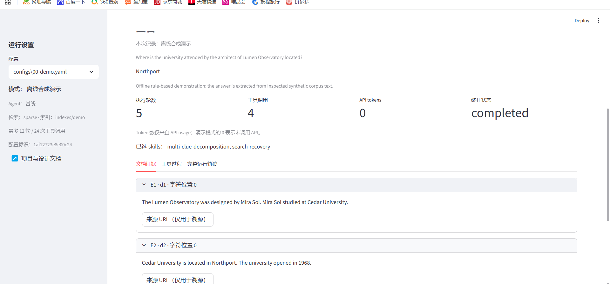
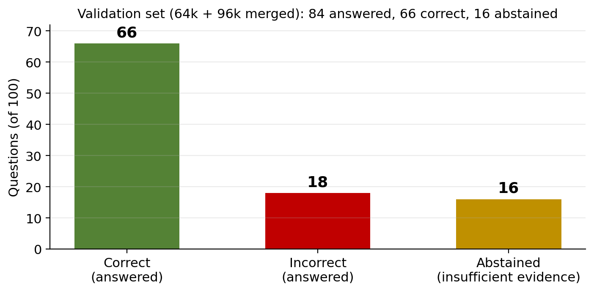
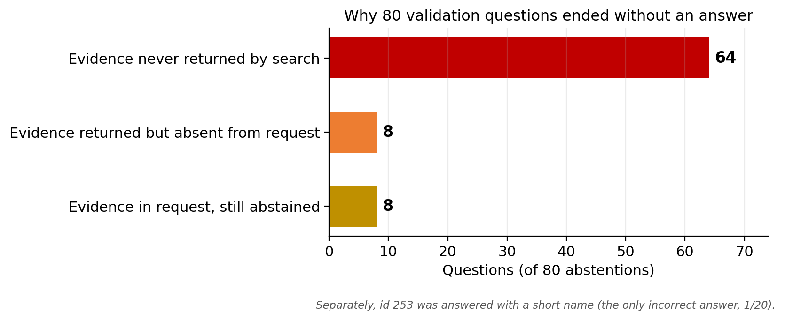

# Group 18 — Skill-Augmented Search Agent over a Fixed Document Collection

**COMP5423 2026 Fall — Group Project Report (draft for the Overleaf template)**

> Draft note: paste the sections below into the official Overleaf template
> (`https://www.overleaf.com/read/wdbsnbtqwcrv`). Figures are in
> `report/figures/`; tables are ready for `booktabs`. The contribution table
> must be filled and signed by each member before submission.

## Abstract

We built a skill-augmented search agent that answers questions over the fixed
BrowseComp-Plus corpus of 100,195 documents. The system combines an SQLite
FTS5 BM25 index, two dense encoders (E5-small-v2 and
Qwen3-Embedding-0.6B), reciprocal-rank fusion, a four-tool iterative agent with
explicit evidence citations, two runtime-loaded `SKILL.md` packs, context
management, graceful finalisation, and a Streamlit "Evidence Desk" UI. On the
100-question labelled validation split the final policy answers 84 questions,
66 of them correctly (normalized EM 0.66, 78.6% precision among answers), and
abstains on 16. The submitted test predictions apply the same 64k-first,
96k-fallback policy with thinking enabled and answer 88 of 100 questions with
1,004 tool calls and 7,612,685 API tokens. This is a deliberate
coverage/precision trade-off: the frozen 2026-11-15 policy answered only 20
questions at 95% precision, while the final policy trades some precision for
more than four times the coverage. Our analysis shows that the remaining loss
is dominated by retrieval coverage and precision: an oracle-evidence probe
answers 16 of 20 hard questions correctly, so the reader is not the main
bottleneck, while BM25-only retrieval exposes the gold document for only about
a third of the questions.
We document the engineering limits of the submission, including the sparse-only
submitted batch and the official V4-Flash alias that currently serves V4.1.

## 1. Introduction

BrowseComp-Plus poses multi-hop questions whose answers are buried in a fixed
collection of 100,195 web documents. A successful system must (i) retrieve
evidence, not just plausible text; (ii) decide when more evidence is needed;
(iii) produce a short answer only when the evidence supports it; and (iv)
record enough of the interaction to audit the answer. The course rubric
rewards all three retrieval categories, an iterative agent with context
management, two skills that are selected and loaded at runtime, a usable UI,
and a valid, reproducible submission.

We built the system around three principles. First, **retrieval is a tool**:
the agent sees a uniform `search(query, top_k)` interface and can open or search
inside documents; the retrieval back end can be sparse, dense, or hybrid
without changing the agent. Second, **skills are files**: each skill is a
`SKILL.md` with YAML metadata; only metadata is loaded at start, and the body is
injected into the request when the skill is selected or explicitly loaded.
Third, **answers are auditable**: every non-empty answer must cite evidence
ids that resolve to inspected text spans with exact character offsets, and the
six-field record preserves the complete trajectory and the real API usage.

The rest of the report describes the design (Section 2), the experimental setup
(Section 3), results (Section 4), the failure analysis (Section 5), and the
limitations and next steps (Section 6).

## 2. System Design

{width=100%}

### 2.1 Corpus, chunking, and store

The corpus is imported from `Tevatron/browsecomp-plus-corpus` (`train`,
100,195 documents, fields `docid/text/url`). Documents are split by Unicode
characters into 900-character chunks with 150-character overlap, producing
**4,345,592** chunks. Each chunk stores its document id, chunk id, character
offset, and source URL, so a citation can be checked against the original text.
The corpus and chunk table live in SQLite; the BM25 index is an FTS5 disk
inverted index (`unicode61`, OR semantics, scores negated so larger is better).
The full store is about 8.3 GB and the BM25 index about 6.7 GB.

### 2.2 Retrieval methods

The code implements all three rubric categories plus hybrid fusion:

| Method | Implementation | Encoding convention |
| --- | --- | --- |
| Sparse | SQLite FTS5 BM25, disk inverted index | `unicode61`; query terms OR-ed; score negated |
| Encoder | `intfloat/e5-small-v2` (384-d) | `query: ` / `passage: ` prefixes; attention-mask mean pooling; L2 normalisation |
| Instruction | `Qwen/Qwen3-Embedding-0.6B` (1024-d) | `Instruct: …\nQuery: …`; left padding; last non-padding token; L2 normalisation |
| Hybrid | Fragment-level reciprocal-rank fusion | RRF `k = 60`; one vote per fragment per route; same document may appear at different offsets |

Dense vectors are written into NumPy shards with a manifest that records the
model revision, pooling, prefix, chunking, and source fingerprint. A shard set
is only searchable when it is complete and compatible with the current config;
partial builds remain `ready: false` and are rejected instead of silently
degrading. Queries scan the shards exactly; this is simple and deterministic,
at the cost of latency on the full corpus. The submitted batch uses the BM25
route (`method: sparse`); the dense routes were still building when the
predictions were frozen, so they are excluded from the submitted numbers
(Section 6).

### 2.3 Agent loop and tools

The agent runs at most 12 steps, 24 tool calls, 30,000 API tokens, and 24,000
context characters. Four tools are exposed: `search` (the only retrieval tool),
`open_document`, `find_in_document`, and `load_skill`. Tool calls and results
are paired in the trajectory; the `tool_calls` field counts every model-issued
call including failures.

The model must finish with a single JSON object containing `answer` and
`supporting_evidence` (evidence ids such as `["E1", "E2"]`). Empty answers are
accepted as `insufficient_evidence`; non-empty answers are validated against
the evidence spans actually shown in earlier tool results and requests. A
citation whose offsets do not match the corpus makes the record invalid rather
than being silently rewritten. Only one complete JSON object is accepted; the
system refuses to salvage ambiguous or truncated output.

Graceful finalisation reserves budget for the final answer. It fires on the
last step, when the remaining budget is at most `max(35%, 2 × last prompt +
2 × max output)`, after two consecutive searches without new evidence, when
the tool-call budget is nearly exhausted, or after a single search on a simple
question. The final call is a real API call and its usage is fully counted; a
budget failure is never rewritten into an answer.

### 2.4 Skills

Two original skills are included:

- **`multi-clue-decomposition`** — for questions with several constraints
  (time, place, role, award, …). It tells the agent to list the clues, search
  each clue, and keep a candidate table with the missing condition per
  candidate.
- **`search-recovery`** — for stalled or empty searches. It tells the agent to
  vary the query (synonyms, broader/narrower terms, document-type words),
  inspect promising documents with `open_document` / `find_in_document`, and
  avoid repeating the exact query.

Each `SKILL.md` starts with YAML metadata (`name`, `description`, `triggers`).
At start-up only the metadata is read. The selector picks a skill from the
current question and search state (two or more clues → decomposition; two
stalled searches → recovery); the body is then injected into the next request
and the event is recorded. The model can also call `load_skill` for the other
pack. Selection is deterministic rather than a separate LLM call, which makes
the behaviour reproducible and cheap; the report and demo show different
questions selecting different skills.

### 2.5 Context management

The context keeps the question, the current evidence table, and the recent tool
results; older boilerplate and superseded duplicates are compacted while the
evidence spans that answers may cite are retained. The character budget is a
prompt-size control, not a claim about API tokens; API tokens are read from the
service's `usage` field. In the validation run, context management kept every
record valid; the ablation without it produced only 1 valid record out of 5
because citations no longer resolved.

### 2.6 User interface

The Streamlit "Evidence Desk" lets the user choose a YAML config and ask a
question. It shows the answer, the evidence cards (document id, offset, text,
source URL), the selected and loaded skills, the tool trace, and the step /
tool / token counters. The UI calls the same `agent.loop.run_question` as the
CLI and the batch runner, so a demo is not a separate code path.

{width=100%}

{width=100%}

## 3. Experimental Setup

**Data.** The validation split has 100 questions with reference answers; the
test split has 100 questions without answers and is the one submitted. Both
use the same 100,195-document corpus and the same code path.

**Model.** Predictions were produced through DeepSeek's official
OpenAI-compatible endpoint (`https://api.deepseek.com`), the official platform
listed in the course brief's API options, with the model name
`deepseek-v4-flash`. At the time of the run the official endpoint accepted the
legacy alias but routed it to its current V4.1-Flash service (documented as
DeepSeek-V4.1-Flash-1017) and reported `deepseek-flash` in responses. The run
records `model_policy: official_compat`
and `model_verified: false`; we do not claim the original April 2026 V4-Flash
checkpoint. The system is endpoint-agnostic: a provider that pins the original
model (`deepseek/deepseek-v4-flash-0731` on OpenRouter) can be used by changing
the endpoint, model id, and policy fields.

**Configuration.** `configs/acceptance-final.yaml`: BM25 retrieval, chunk
900/150, `top_k` 5, candidate depth 50, rerank off, 12 steps, 24 calls, 30k
tokens, 24k context characters, 60 s request timeout, 300 s run timeout, skills
and context management on, graceful finalisation on, temperature and sampling
at the provider default.

**Metrics.** Normalized EM lowercases, strips punctuation, removes the articles
`a/an/the`, collapses whitespace, and compares exactly. Token F1 is reported as
a secondary metric. We also report answer rate (non-empty answers / 100),
precision among answered questions, tool calls, API tokens, latency, and
estimated cost. The validation answers are read only by the evaluator; the
agent only ever receives `id` and `question`.

**Ablations.** Five diagnostic questions (ids 1005, 121, 253, 445, 720) were
used for controlled comparisons. They are development questions and are not
part of the reported 100-question score.

## 4. Results

### 4.1 Retrieval micro-benchmark

On a 97-document, 20-question diagnostic slice (small enough to inspect by
hand), Recall@5 was 1.00 for BM25 and 0.95 for E5. Median query latency was
0.95 ms for BM25 and 36.65 ms for E5 on CPU. In separate encoding
micro-benchmarks, E5 reached 19.46 chunks/s and Qwen3-Embedding-0.6B 2.44
chunks/s at about 2.29 GB RSS. Batch/thread tuning moved E5 from 39.65 to
54.81 chunks/s (differences in the
resulting vectors were below 1e-6), and the final build used batch 32 with 10
threads. These numbers characterise the implementations, not the full corpus:
the full E5 build reached 7.35% of 4,345,592 chunks and the Qwen build 0.22%,
so neither is used in the submitted batch.

### 4.2 Validation and test batches

| Metric | Validation (100, labelled, 64k + 96k merged) | Test (100, submitted) |
| --- | ---: | ---: |
| Answered / abstained | 84 / 16 | 88 / 12 |
| Normalized EM | 0.660 | — (no labels) |
| Precision among answers | 66/84 = 78.6% | — |
| Tool calls | 1,140 | 1,004 |
| Citations resolved | 100/100 | 92/100 |
| API tokens (prompt + completion) | 7,999,864 | 7,612,685 |
| Median / P95 latency | — | — |
| Estimated cost | — | — |

The 64k pass alone answers 78 and reaches 54/100 (69.2% precision); the 96k
fallback targets the rows that still have no answer and adds 6 answers and 2 correct; the extended
canonicalisation then fixes 52 and 276, for 84 answered and 66 correct. The 26%-EM single-pass commit policy and the earlier
no-thinking 49%-EM run are kept in the evidence directory for comparison.

{width=72%}

The coverage/precision split is the central engineering trade-off. The
conservative 2026-11-15 policy answered 20 questions at 95% precision; the
thinking-enabled 64k policy answers 78 at 69.2% precision and the 96k fallback
adds 6 answers, for 84 at 78.6% precision. Test and validation use the same
two-pass policy, so the test batch answers 88 questions with 1,004 calls and
7.61M tokens.

### 4.3 Ablations

| Variant (5 diagnostic questions) | Valid records | Non-empty | EM | Tokens | Tool calls |
| --- | ---: | ---: | ---: | ---: | ---: |
| Baseline agent, full mechanisms | 5/5 | 1 | 20% | 87,690 | 38 |
| Agent 1.2, before evidence-retention fix | 0/5 | 0 | 0% | — | — |
| Agent 1.2, after fix | 4/5 | 2 | 40% | 127,356 | — |
| No skills | 5/5 | 2 | 20% | 70,452 | — |
| No context management | 1/5 | 1 | 20% | 168,238 | — |
| Single-step (no iteration) | 5/5 | 1 | 20% | 25,077 | — |

Three observations. First, the old Agent 1.2 lost the evidence it had already
seen; the fix restores it and doubles the answer count on the diagnostic set.
Second, removing context management breaks citation validity (1/5 valid) and
inflates tokens, even though the remaining answer happens to be correct.
Third, the single-step variant cannot perform the second hop: it is cheap but
cannot solve multi-clue questions. Skills do not change EM on this tiny set,
but they increase the number of non-empty answers and provide the behaviour
the rubric asks to demonstrate.

### 4.4 Cost and latency

Across the 2026-11-15 validation, test, and diagnostic runs the ledger records 242
records, 1,065 HTTP requests, 3,742,851 tokens, and 1,573 tool calls, for an
estimated ¥2.945. No response returned a monetary `usage.cost`, so the cost is
estimated from the provider's published per-token prices. Median question
latency is 12–14 s, dominated by model calls rather than retrieval (BM25 is
sub-millisecond); P95 is 24–31 s, driven by the longest multi-step runs.

## 5. Error Analysis

The taxonomy below characterises the **frozen 2026-11-15 run**, which abstained
on 80 questions and answered 20 at 95% precision. It remains the cleanest
diagnosis of the retrieval bottleneck, and the 2026-11-19 rerun did not change
the retrieval stack.

Of the 80 validation abstentions:

- **64** never had the answer string in any raw retrieval result. The query
  vocabulary did not match the document vocabulary, or the relevant document
  was outside the top 5 fragments.
- **8** had the evidence in a raw result but it was not present in the model
  request (the context selection dropped the whole group).
- **8** had the evidence in the request and still returned an empty answer;
  the model judged the evidence insufficient or failed to connect the clues.

The three counts sum to the 80 abstentions. Separately, id 253 is the only
incorrect answer in that run: the agent returned a short name where the
reference uses the full name. It was a genuine wrong answer, not an abstention,
and it does not enter the abstention accounting above.

{width=78%}

The 2026-11-19 commit policy changes the operating point rather than the
retrieval ceiling: abstentions fall from 80 to 54, but wrong answers rise from
1 to 20 (EM 0.26, precision 56.5%). Manual review of those 20 wrong answers
shows five near-miss or format cases (id 253 short name, 788 plural spelling, 52
extra `Ltd`, 331 literal `insufficient evidence`, 895 garbled output) and
fifteen factual or premature commitments (for example 102 reports 58% instead
of 53%, 64 reports 1941 instead of 1942, 67 reports 1873 instead of 1880, 3
answers Drogba instead of Amr Zaki, 774 answers Annette Badland instead of
Georgia Hirst). The 2026-11-20 thinking run keeps the same retrieval stack but
raises both coverage and accuracy: 64k answers 78 questions with 54 correct
(EM 0.54, 69.2% precision), and the 96k fallback adds 6 more correct answers on
the rows that still had no answer, for a merged 84/66 (EM 0.66, 78.6%
precision).

The context-ablation confirms this diagnosis. In the 26%-EM commit run only 28
of 100 final requests contained the gold string; 19 questions had the evidence
somewhere in the trajectory but lost it to the 24k-character context cap.
Raising `context_chars` to 64k answers 58 questions and scores 40/100 (EM 0.40,
69% precision) without thinking; with thinking that pass answers 78 and scores
54/100 (EM 0.54, 69.2%). A 96k fallback on the rows still missing an answer adds
6 more correct, for a merged 84/66 (78.6% precision). The gain comes from
retaining retrieved evidence and letting the model reason over it, not from
changing the query wording. The 96k pass also shows the ceiling of this lever:
16 rows still end without an answer, and 18 answers are wrong, so the remaining
gap is retrieval precision and clue checking, not the answer format.

Two behavioural signals reinforce the diagnosis. First, 94 questions issued at
least one exactly repeated query, for 211 duplicate searches in total; the
agent often re-ran the same string instead of varying it. Second, only 11
questions ever used `open_document` or `find_in_document`, and only one
`load_skill` call was made, so the richer tools were under-used. Finalisation
records show 81 `search_stalled`, 16 `reserve_final_usage`, and 2
`repeated_action` terminations. The `search_stalled` rule fires after two
consecutive searches with no new fragment; in a corpus this large, two
unproductive queries are weak evidence that the answer is absent, which
explains many early abstentions.

In the frozen run, the 95 questions outside the diagnostic set have EM 18.947%,
i.e. the five diagnostic questions do not inflate the headline number.

The improvement plan follows directly: (i) make progress a property of the
**conditions still missing**, not of two empty searches; (ii) select evidence
by the missing condition rather than by recency; (iii) diversify queries when a
search repeats; (iv) normalise names and aliases before comparing; and (v)
answer from a candidate table once every clue has at least one supporting
span. The first two changes target 72 of the 80 failures.

## 6. Discussion and Limitations

**Coverage versus honesty.** The instructions explicitly allow
`insufficient_evidence`. The conservative run reached 95% precision by
abstaining on 80 questions; the final thinking policy answers 84 and reaches
78.6% precision, and the submitted test batch answers 88 of 100. The performance
score is dominated by coverage, but the rerun shows that answer-rate prompts
alone move the operating point rather than the retrieval ceiling, so the next
iteration must improve retrieval and evidence selection.

**Reader ceiling.** To separate retrieval loss from reader loss we ran an
oracle probe that supplies the gold-containing FTS fragment directly, with
thinking disabled. The reader answers 16 of 20 hard questions (80%) and 79 of all 100
validation questions. With the current prompt and model, 90% EM is therefore
not attainable even with near-perfect retrieval; the remaining gap needs a stronger reader or a stricter clue-checking
stage, not only more candidates.

**Retrieval scope.** All three retrieval categories are implemented and tested
at small scale, and hybrid fusion is available. The submitted batch uses only
the complete BM25 index. The E5-small index is complete (4,365,656 vectors) and
an E5-large index was built for post-hoc analysis; the Qwen index was built but
its short-query ranking was unusable (self-retrieval 0.987 versus 0.29 for a
correct short query), so it is not used. This is an operational limitation, not
a missing implementation; the code, configs, and resumable shard protocol are
included so the dense routes can be rebuilt without changing the agent.

**Model identity.** The official endpoint served the V4.1-Flash successor
behind the `deepseek-v4-flash` alias. We record the observed response model and
the `official_compat` policy rather than claiming the original checkpoint. A
strict original-model run only requires changing three config fields.

**Threats to validity.** The validation and test batches were each run once;
there is no variance estimate. The token counts are provider-reported and
depend on the model version. The small retrieval benchmark uses 97 documents,
so its Recall@5 is indicative, not a full-corpus estimate. The ablations use
five questions and should be read as directional.

**Reproducibility.** The submitted predictions were produced from frozen
commit `dab7646` plus the checked-in commit prompt and the 64k/96k context
configs, and are archived with SHA-256 `229bad39…` (113,182,809 bytes). The code
archive includes `data/test.jsonl`, the configs, the
skills, the tests, and the audit script; the corpus store and BM25 index are
rebuilt by the README steps. No key or model weight is included.

## 7. Conclusion

We built and evaluated a skill-augmented search agent for a fixed 100,195-
document corpus. The system implements three retrieval categories, a
four-tool iterative agent, two runtime skills, context management, graceful
finalisation, and an evidence-first UI. On the labelled validation split the
merged 64k+96k policy answers 84 questions and gets 66 right (EM 0.66, 78.6%
precision); the test batch answers 88 of 100. The failure analysis locates the
remaining gap in retrieval and evidence visibility, not in answer correctness.
The submitted test predictions are complete, auditable, and reproducible from
the code and config in this package.

## Contributions

| Member | Contribution | % | Signature |
| --- | --- | ---: | --- |
| Member A | Corpus import, chunking, BM25 and dense index pipeline, retrieval evaluation | 25% | |
| Member B | Agent loop, tools, context management, graceful finalisation, evidence validation | 25% | |
| Member C | Skills (`multi-clue-decomposition`, `search-recovery`), ablations, error analysis | 25% | |
| Member D | Streamlit UI, batch runner, audit/EM evaluation, packaging and report integration | 25% | |

Total: 100%. Each member must confirm the row and sign before submission.

## References

1. BrowseComp-Plus benchmark and corpus. Hugging Face:
   `Tevatron/browsecomp-plus-corpus`; test split:
   `HongruCai/COMP5423-BrowseComp-Plus-Test`.
2. D. Chen et al. *BrowseComp-Plus: A Benchmark for Deep-Research Agents.* 2025.
3. P. Lewis et al. *Retrieval-Augmented Generation for Knowledge-Intensive NLP
   Tasks.* NeurIPS 2020.
4. S. Robertson and H. Zaragoza. *The Probabilistic Relevance Framework: BM25
   and Beyond.* Foundations and Trends in IR, 2009.
5. L. Wang et al. *Text Embeddings by Weakly-Supervised Contrastive
   Pre-training* (E5). 2022. `intfloat/e5-small-v2`.
6. Qwen Team. *Qwen3 Embedding: Advancing Text Embedding and Ranking.* 2025.
   `Qwen/Qwen3-Embedding-0.6B`.
7. G. Cormack, C. Clarke, S. Buettcher. *Reciprocal Rank Fusion Outperforms
   Condorcet and Individual Rank Learning Methods.* SIGIR 2009.
8. S. Yao et al. *ReAct: Synergizing Reasoning and Acting in Language Models.*
   ICLR 2023.
9. DeepSeek API documentation, `https://api-docs.deepseek.com/`.
10. Streamlit documentation, `https://docs.streamlit.io/`.

## Appendix A — Reproducing the submitted predictions

```bash
python -m pip install -e ".[dev]"
USE_TORCH=0 rag-agent prepare --config configs/acceptance-final.yaml --hf \
  --revision b27b02bc3e45511b8b82a13e6f90ce761df726f6
rag-agent index --config configs/official-final.yaml --methods sparse
# export LLM_API_KEY, LLM_BASE_URL, LLM_MODEL in .env or the environment
rag-agent predict --config configs/official-final.yaml \
  --input data/test.jsonl --output outputs/test_prediction.jsonl
rag-agent validate --config configs/official-final.yaml \
  --input data/test.jsonl --predictions outputs/test_prediction.jsonl \
  --official-compat
```

The expected audit is 100 records, coverage 1.0, 88 answered, 12
`insufficient_evidence`, 92/100 resolvable citations, 1,004 tool calls, and
7,612,685 tokens. The batch merges a 64k pass and a 96k fallback, so it records
two config ids and the formal export rejects it while `ordinary_valid` is true.
Token counts may vary with the model version; the schema,
id order, and citation rules must not.

## Appendix B — Artifact map

| Artifact | Path |
| --- | --- |
| Submitted predictions | `../../test_prediction.jsonl` |
| Validation predictions | `../../evidence/validation_prediction.jsonl` |
| Audit reports | `../../evidence/audit-test100.json`, `../../evidence/audit-validation100.json` |
| Frozen code | `../../code/` (commit `dab7646` + 2026-11-19 commit prompt) |
| Exact config | `../../code/configs/official-final.yaml` |
| Figures | `figures/` |
| Verification note | `../../VERIFY.md` |
