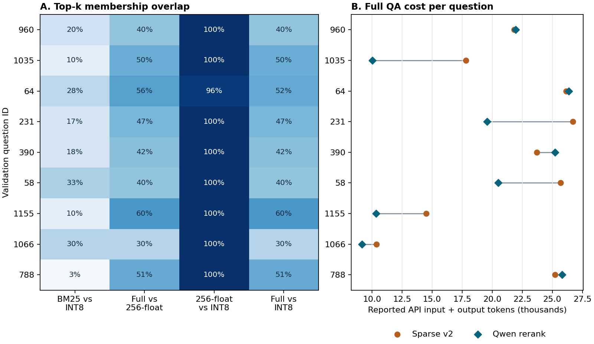

# 九题比较图说明

左侧每格对应一个题号的全部真实搜索和一组同池排名比较，显示前 k 名成员重合的百分比，分母为该题实际返回结果位置总数。原始向量为 2,560 维，前缀浮点与 int8 均为 256 维。前缀浮点与 int8 的总体重合为 259/260 (99.6%)。颜色越深表示前 k 名的组成越接近，不能据此判定回答正确。

右侧每一行对应同一道完整问答，圆点为历史 sparse v2，菱形为本次 Qwen 候选重排，横轴以千为单位表示服务商报告的输入和输出 token 之和。相连点之间的距离取决于问答路径与实际输入长度。两幅图均为已观测值，每种配置每题一次，没有重复运行可用于画误差条。准确分子、分母、逐题原始值和文件校验值见[统计附录](stats-appendix.md)。
