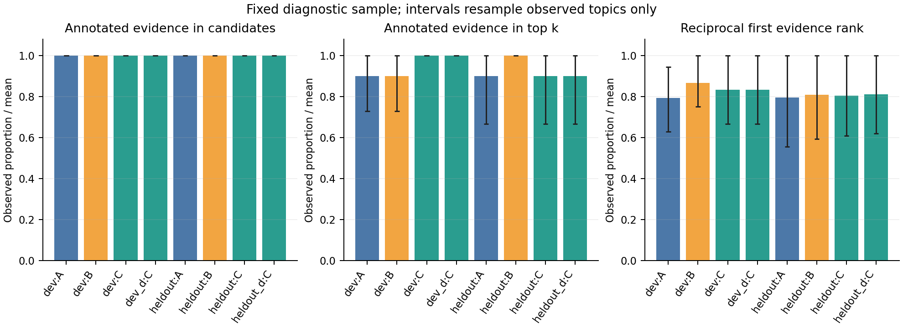
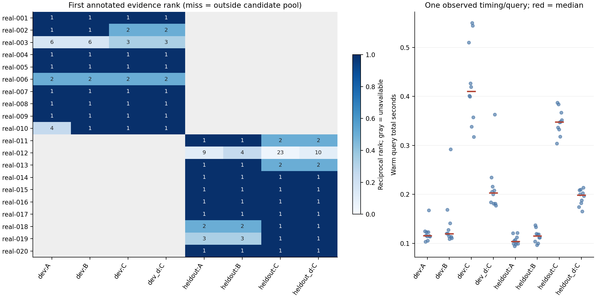
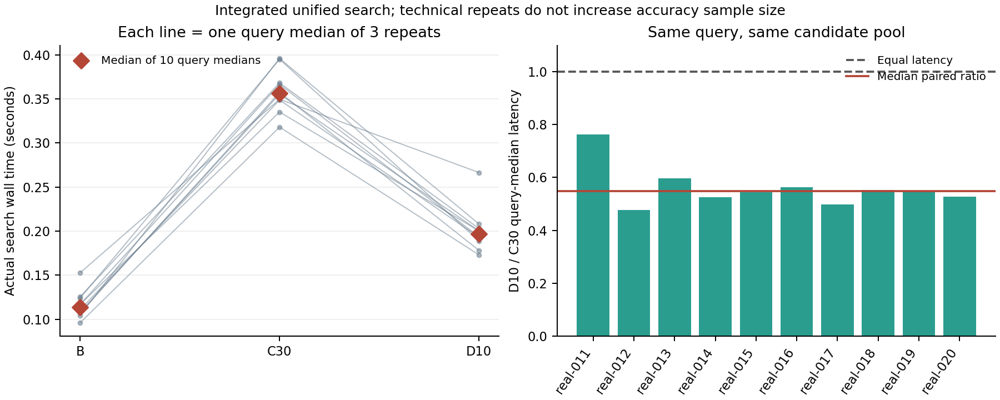

# 固定语料重排：严格描述性分析

## 分析问题

B−A 检查扩大候选深度；C−B 在同一候选池内检查本地重排。显式跨运行对照检查第二轮单因素修改。
主指标为已标注原文证据 Hit@k；候选覆盖、首证据 MRR、文档命中和预热后耗时分别报告。

## 已核验数据与准确数字

| Run:group | Valid / requested | Topics | Candidate hit | Evidence Hit@k | Evidence MRR | Document Hit@k | Median total s |
|---|---:|---:|---:|---:|---:|---:|---:|
| dev:A | 10 / 10 | 8 | 1.000 | 0.900 | 0.792 | 1.000 | 0.116 |
| dev:B | 10 / 10 | 8 | 1.000 | 0.900 | 0.867 | 1.000 | 0.120 |
| dev:C | 10 / 10 | 8 | 1.000 | 1.000 | 0.833 | 1.000 | 0.410 |
| dev_d:A | 10 / 10 | 8 | 1.000 | 0.900 | 0.792 | 1.000 | 0.116 |
| dev_d:B | 10 / 10 | 8 | 1.000 | 0.900 | 0.867 | 1.000 | 0.120 |
| dev_d:C | 10 / 10 | 8 | 1.000 | 1.000 | 0.833 | 1.000 | 0.203 |
| heldout:A | 10 / 10 | 9 | 1.000 | 0.900 | 0.794 | 1.000 | 0.104 |
| heldout:B | 10 / 10 | 9 | 1.000 | 1.000 | 0.808 | 1.000 | 0.115 |
| heldout:C | 10 / 10 | 9 | 1.000 | 0.900 | 0.804 | 1.000 | 0.348 |
| heldout_d:A | 10 / 10 | 9 | 1.000 | 0.900 | 0.794 | 1.000 | 0.104 |
| heldout_d:B | 10 / 10 | 9 | 1.000 | 1.000 | 0.808 | 1.000 | 0.115 |
| heldout_d:C | 10 / 10 | 9 | 1.000 | 0.900 | 0.810 | 1.000 | 0.198 |

| Comparison (right − left) | Pairs | Hit improve / tie / regress | Δ Hit percentage points | Δ MRR | Δ median total s |
|---|---:|---:|---:|---:|---:|
| dev:B − dev:A | 10 | 0 / 10 / 0 | 0.0 | 0.075 | 0.004 |
| dev:C − dev:B | 10 | 1 / 9 / 0 | 10.0 | -0.033 | 0.266 |
| dev_d:B − dev_d:A | 10 | 0 / 10 / 0 | 0.0 | 0.075 | 0.004 |
| dev_d:C − dev_d:B | 10 | 1 / 9 / 0 | 10.0 | -0.033 | 0.069 |
| heldout:B − heldout:A | 10 | 1 / 9 / 0 | 10.0 | 0.014 | 0.009 |
| heldout:C − heldout:B | 10 | 0 / 9 / 1 | -10.0 | -0.004 | 0.233 |
| heldout_d:B − heldout_d:A | 10 | 1 / 9 / 0 | 10.0 | 0.014 | 0.009 |
| heldout_d:C − heldout_d:B | 10 | 0 / 9 / 1 | -10.0 | 0.002 | 0.078 |
| dev_d:C − dev:C | 10 | 0 / 10 / 0 | 0.0 | 0.000 | -0.188 |
| heldout_d:C − heldout:C | 10 | 0 / 10 / 0 | 0.0 | 0.006 | -0.153 |

有效配对仅包含两端成功且具备有效片段标注的题目；降级、失败和未完成均单独保留，未伪装成重排成功。
所有 B/C 成功对照已核验候选池 SHA256 和候选 ID 集相同。按题目 ID 配对，不能把片段当作样本。

回放运行中的 A/B 是原候选与原计时的副本，不是新增独立实验；各运行单独列出，不合并扩充样本量。

## 图与解释

图 1 区分候选是否含证据和最终是否呈现证据。只有候选覆盖相同的 C−B 对照能用于判断排序作用。
误差线是对已观察主题组重抽样的 95% 条件区间，用于查看小样本敏感性；不代表总体置信区间。

图中省略回放 A/B 的重复列，完整数值仍保留在表格与 JSON 中。

图 2 展示是哪道题发生了变化，以及每个实际查询的耗时。红线为中位数，没有把单次运行误作多次重复。
跨运行回放会复用原检索耗时；仅重排耗时是新测量，因此总耗时属于组合估计，不是一次新的端到端计时。

## 失败、范围和不确定性

固定小语料上的人工编写、非随机抽样诊断题；没有独立重复实验或随机种子重复。主题内查询相关，因此不把查询、片段或重复读取当作独立实验。不执行总体显著性检验，不声称全量课程表现或总体胜出。
部分证据标签只衡量已标注范围；未命中标注不等于没有任何有效证据。未标注候选的相关性未知。
未提供独立全量测试、官方课程验证题或跨会话独立重复数据，因此这些结果不能支持课程 EM、总体泛化或稳定尾延迟结论。

## Claim Candidates

### 逐题复核入口

| Comparison | ID | First evidence rank | First evidence chunk before → after |
|---|---|---|---|
| dev:A → dev:B | real-010 | 4 → 1 | `10838:2250:897` → `10838:2250:897` |
| dev:A → dev:B | real-001 | 1 → 1 | `5412:0:900` → `5412:0:900` |
| dev:B → dev:C | real-002 | 1 → 2 | `68484:750:900` → `68484:750:900` |
| dev:B → dev:C | real-003 | 6 → 3 | `6753:2250:900` → `6753:2250:900` |
| dev:B → dev:C | real-001 | 1 → 1 | `5412:0:900` → `5412:0:900` |
| dev_d:A → dev_d:B | real-010 | 4 → 1 | `10838:2250:897` → `10838:2250:897` |
| dev_d:A → dev_d:B | real-001 | 1 → 1 | `5412:0:900` → `5412:0:900` |
| dev_d:B → dev_d:C | real-002 | 1 → 2 | `68484:750:900` → `68484:750:900` |
| dev_d:B → dev_d:C | real-003 | 6 → 3 | `6753:2250:900` → `6753:2250:900` |
| dev_d:B → dev_d:C | real-001 | 1 → 1 | `5412:0:900` → `5412:0:900` |
| heldout:A → heldout:B | real-012 | 9 → 4 | `18690:5250:730` → `18690:5250:730` |
| heldout:A → heldout:B | real-011 | 1 → 1 | `10402:1500:900` → `10402:1500:900` |
| heldout:B → heldout:C | real-011 | 1 → 2 | `10402:1500:900` → `10402:1500:900` |
| heldout:B → heldout:C | real-012 | 4 → 23 | `18690:5250:730` → `18690:5250:730` |
| heldout:B → heldout:C | real-013 | 1 → 2 | `52526:0:900` → `52526:0:900` |
| heldout:B → heldout:C | real-018 | 2 → 1 | `7675:750:900` → `7675:750:900` |
| heldout:B → heldout:C | real-019 | 3 → 1 | `70534:1500:900` → `70534:1500:900` |
| heldout:B → heldout:C | real-014 | 1 → 1 | `84039:750:900` → `84039:750:900` |
| heldout_d:A → heldout_d:B | real-012 | 9 → 4 | `18690:5250:730` → `18690:5250:730` |
| heldout_d:A → heldout_d:B | real-011 | 1 → 1 | `10402:1500:900` → `10402:1500:900` |
| heldout_d:B → heldout_d:C | real-011 | 1 → 2 | `10402:1500:900` → `10402:1500:900` |
| heldout_d:B → heldout_d:C | real-012 | 4 → 10 | `18690:5250:730` → `18690:5250:730` |
| heldout_d:B → heldout_d:C | real-013 | 1 → 2 | `52526:0:900` → `52526:0:900` |
| heldout_d:B → heldout_d:C | real-018 | 2 → 1 | `7675:750:900` → `7675:750:900` |
| heldout_d:B → heldout_d:C | real-019 | 3 → 1 | `70534:1500:900` → `70534:1500:900` |
| heldout_d:B → heldout_d:C | real-014 | 1 → 1 | `84039:750:900` → `84039:750:900` |
| dev:C → dev_d:C | real-001 | 1 → 1 | `5412:0:900` → `5412:0:900` |
| heldout:C → heldout_d:C | real-012 | 23 → 10 | `18690:5250:730` → `18690:5250:730` |
| heldout:C → heldout_d:C | real-011 | 2 → 2 | `10402:1500:900` → `10402:1500:900` |

数值不变的样本用于核对持平行为；排名变化不一定跨越 top_k 边界。

- Claim: dev:B 相对 dev:A 的已标注证据呈现表现由冻结样本配对结果描述。
  - Source evidence: metrics.json 的 comparisons；有效配对 10。
  - Allowed wording: Hit@k 改善 / 持平 / 退化为 0 / 10 / 0；平均 MRR 差 0.075。
  - Forbidden stronger wording: 显著提高总体正确率、已证明全量收益或已证明课程成绩提高。
  - Uncertainty: 人工诊断题、部分标签、较少独立主题；单次查询计时。
  - Next check: 在未参与选择的主题和官方验证题上检查覆盖与端到端回答。
  - Decision: keep（仅保留样本内描述）

- Claim: dev:C 相对 dev:B 的已标注证据呈现表现由冻结样本配对结果描述。
  - Source evidence: metrics.json 的 comparisons；有效配对 10。
  - Allowed wording: Hit@k 改善 / 持平 / 退化为 1 / 9 / 0；平均 MRR 差 -0.033。
  - Forbidden stronger wording: 显著提高总体正确率、已证明全量收益或已证明课程成绩提高。
  - Uncertainty: 人工诊断题、部分标签、较少独立主题；单次查询计时。
  - Next check: 在未参与选择的主题和官方验证题上检查覆盖与端到端回答。
  - Decision: keep（仅保留样本内描述）

- Claim: dev_d:B 相对 dev_d:A 的已标注证据呈现表现由冻结样本配对结果描述。
  - Source evidence: metrics.json 的 comparisons；有效配对 10。
  - Allowed wording: Hit@k 改善 / 持平 / 退化为 0 / 10 / 0；平均 MRR 差 0.075。
  - Forbidden stronger wording: 显著提高总体正确率、已证明全量收益或已证明课程成绩提高。
  - Uncertainty: 人工诊断题、部分标签、较少独立主题；单次查询计时。
  - Next check: 在未参与选择的主题和官方验证题上检查覆盖与端到端回答。
  - Decision: keep（仅保留样本内描述）

- Claim: dev_d:C 相对 dev_d:B 的已标注证据呈现表现由冻结样本配对结果描述。
  - Source evidence: metrics.json 的 comparisons；有效配对 10。
  - Allowed wording: Hit@k 改善 / 持平 / 退化为 1 / 9 / 0；平均 MRR 差 -0.033。
  - Forbidden stronger wording: 显著提高总体正确率、已证明全量收益或已证明课程成绩提高。
  - Uncertainty: 人工诊断题、部分标签、较少独立主题；单次查询计时。
  - Next check: 在未参与选择的主题和官方验证题上检查覆盖与端到端回答。
  - Decision: keep（仅保留样本内描述）

- Claim: heldout:B 相对 heldout:A 的已标注证据呈现表现由冻结样本配对结果描述。
  - Source evidence: metrics.json 的 comparisons；有效配对 10。
  - Allowed wording: Hit@k 改善 / 持平 / 退化为 1 / 9 / 0；平均 MRR 差 0.014。
  - Forbidden stronger wording: 显著提高总体正确率、已证明全量收益或已证明课程成绩提高。
  - Uncertainty: 人工诊断题、部分标签、较少独立主题；单次查询计时。
  - Next check: 在未参与选择的主题和官方验证题上检查覆盖与端到端回答。
  - Decision: keep（仅保留样本内描述）

- Claim: heldout:C 相对 heldout:B 的已标注证据呈现表现由冻结样本配对结果描述。
  - Source evidence: metrics.json 的 comparisons；有效配对 10。
  - Allowed wording: Hit@k 改善 / 持平 / 退化为 0 / 9 / 1；平均 MRR 差 -0.004。
  - Forbidden stronger wording: 显著提高总体正确率、已证明全量收益或已证明课程成绩提高。
  - Uncertainty: 人工诊断题、部分标签、较少独立主题；单次查询计时。
  - Next check: 在未参与选择的主题和官方验证题上检查覆盖与端到端回答。
  - Decision: keep（仅保留样本内描述）

- Claim: heldout_d:B 相对 heldout_d:A 的已标注证据呈现表现由冻结样本配对结果描述。
  - Source evidence: metrics.json 的 comparisons；有效配对 10。
  - Allowed wording: Hit@k 改善 / 持平 / 退化为 1 / 9 / 0；平均 MRR 差 0.014。
  - Forbidden stronger wording: 显著提高总体正确率、已证明全量收益或已证明课程成绩提高。
  - Uncertainty: 人工诊断题、部分标签、较少独立主题；单次查询计时。
  - Next check: 在未参与选择的主题和官方验证题上检查覆盖与端到端回答。
  - Decision: keep（仅保留样本内描述）

- Claim: heldout_d:C 相对 heldout_d:B 的已标注证据呈现表现由冻结样本配对结果描述。
  - Source evidence: metrics.json 的 comparisons；有效配对 10。
  - Allowed wording: Hit@k 改善 / 持平 / 退化为 0 / 9 / 1；平均 MRR 差 0.002。
  - Forbidden stronger wording: 显著提高总体正确率、已证明全量收益或已证明课程成绩提高。
  - Uncertainty: 人工诊断题、部分标签、较少独立主题；单次查询计时。
  - Next check: 在未参与选择的主题和官方验证题上检查覆盖与端到端回答。
  - Decision: keep（仅保留样本内描述）

- Claim: dev_d:C 相对 dev:C 的已标注证据呈现表现由冻结样本配对结果描述。
  - Source evidence: metrics.json 的 comparisons；有效配对 10。
  - Allowed wording: Hit@k 改善 / 持平 / 退化为 0 / 10 / 0；平均 MRR 差 0.000。
  - Forbidden stronger wording: 显著提高总体正确率、已证明全量收益或已证明课程成绩提高。
  - Uncertainty: 人工诊断题、部分标签、较少独立主题；单次查询计时。
  - Next check: 在未参与选择的主题和官方验证题上检查覆盖与端到端回答。
  - Decision: keep（仅保留样本内描述）

- Claim: heldout_d:C 相对 heldout:C 的已标注证据呈现表现由冻结样本配对结果描述。
  - Source evidence: metrics.json 的 comparisons；有效配对 10。
  - Allowed wording: Hit@k 改善 / 持平 / 退化为 0 / 10 / 0；平均 MRR 差 0.006。
  - Forbidden stronger wording: 显著提高总体正确率、已证明全量收益或已证明课程成绩提高。
  - Uncertainty: 人工诊断题、部分标签、较少独立主题；单次查询计时。
  - Next check: 在未参与选择的主题和官方验证题上检查覆盖与端到端回答。
  - Decision: keep（仅保留样本内描述）

## 补充：统一 search 的直接重复计时

本节是对实际 `SearchService.search` 的完整查询墙钟计时；三模型在同一进程中常驻，预热后轮换 B/C/D 的执行顺序。哈希核对开销在计时之外。它取代回放组合值作为实际查询延迟的主要依据。
共有 10 道查询，每配置每题 3 次技术重复。先对每题取中位数，再汇总题目中位数；准确率样本量仍为 10，不能乘以技术重复次数。

| Configuration | Queries | Repeats per query | Median query-median total s | Retrieval s | Rerank s |
|---|---:|---:|---:|---:|---:|
| B | 10 | 3 | 0.113804 | 0.113658 | 0.000000 |
| C | 10 | 3 | 0.356493 | 0.110402 | 0.244513 |
| D | 10 | 3 | 0.196910 | 0.112853 | 0.081369 |

各列分别取中位数，所以检索与重排列不必精确加和等于总耗时列。

| Paired comparison | Queries | Median total delta s | Median paired ratio | Faster / tied / slower |
|---|---:|---:|---:|---:|
| C_vs_B | 10 | 0.245250 | 3.168183 | 0 / 0 / 10 |
| D_vs_C | 10 | -0.160604 | 0.547614 | 10 / 0 / 0 |
| D_vs_B | 10 | 0.079780 | 1.727722 | 0 / 0 / 10 |

D10/C30 的逐题耗时比中位数为 0.547614，对应约 45.2% 的典型配对降幅。这是观测到的本机代价变化，不是跨设备或跨会话性能保证。
全部重复的候选池和最终结果均与冻结参考相符；重复没有产生新的准确率证据。

图 3 左侧每条线代表一题的三次计时中位数，右侧给出同题 D10/C30 比值。它支持把 D10 作为较低开销的可选重排配置；能否推荐重排仍须结合保留集的证据退化。
进程峰值 RSS 为 2793046016 字节，包含三套模型与运行时；不能解释为重排器单独内存。
原始技术重复留在本地，脱敏摘要和逐题中位数见 `integrated-summary.json`。

## 可追溯产物

- `metrics.json`：完整描述性统计、配对效应与脱敏运行版本。
- `per-query.csv`：样本 ID、状态、排名、命中和计时，不含问题、答案或原文。
- `stats-appendix.md`：统计单位、区间定义和推断边界。
- `figure-catalog.md`：图的用途、观察和解释范围。
