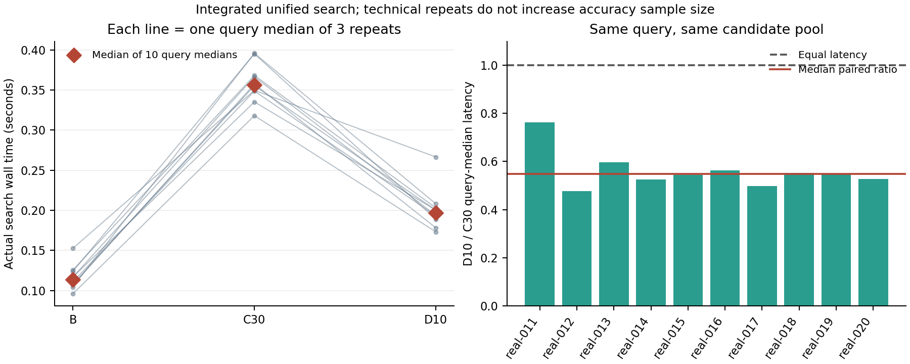

# 统计附录

## 单位与效应

每个冻结查询在不同配置下配对。主题组为重抽样单位，保留组内所有题目；组内题目不视为独立重复。
主效应为 Hit@k 的配对绝对差（百分点），辅助效应为 MRR 差和秒数差。
mean ± SD 描述这组查询的离散程度，不是多种训练种子或重复运行的稳定性。

## 条件重抽样

固定 seed=20261111，重复 5000 次。每次等概率有放回抽取原主题组数，保留抽中主题的全部查询，再计算查询加权均值。表中区间为这些均值的第 2.5/97.5 百分位。
它只检验对已观察主题构成的敏感性。人工选题没有随机抽样总体，因此不称其为总体置信区间。
主题少于两个时不提供区间；全部命中或全不命中可能得到退化区间，不意味着总体没有不确定性。

## 显著性和多重比较

固定小语料上的人工编写、非随机抽样诊断题；没有独立重复实验或随机种子重复。主题内查询相关，因此不把查询、片段或重复读取当作独立实验。不执行总体显著性检验，不声称全量课程表现或总体胜出。
不运行 t 检验、秩和检验或符号检验；没有 p 值，也不存在需要 Holm 校正的已执行检验族。
默认对照为各运行的 B−A 和 C−B；跨运行对照由命令明确指定。图和逐题表保留所有对照，不挑最好结果。

## 完整描述性统计

| Run:group | Metric | n | Mean | SD across queries | Median | Min | Max | 95% topic-resampling interval |
|---|---|---:|---:|---:|---:|---:|---:|---|
| dev:A | evidence_candidate_hit | 10 | 1.000 | 0.000 | 1.000 | 1.000 | 1.000 | [1.000, 1.000] |
| dev:A | evidence_hit_at_k | 10 | 0.900 | 0.316 | 1.000 | 0.000 | 1.000 | [0.727, 1.000] |
| dev:A | evidence_mrr | 10 | 0.792 | 0.345 | 1.000 | 0.167 | 1.000 | [0.629, 0.944] |
| dev:A | evidence_recall_at_k | 10 | 0.900 | 0.316 | 1.000 | 0.000 | 1.000 | [0.727, 1.000] |
| dev:A | document_hit_at_k | 10 | 1.000 | 0.000 | 1.000 | 1.000 | 1.000 | [1.000, 1.000] |
| dev:A | document_mrr | 10 | 0.845 | 0.327 | 1.000 | 0.200 | 1.000 | [0.661, 1.000] |
| dev:A | document_recall_at_k | 10 | 1.000 | 0.000 | 1.000 | 1.000 | 1.000 | [1.000, 1.000] |
| dev:A | retrieval_seconds | 10 | 0.121 | 0.018 | 0.116 | 0.103 | 0.167 | NA |
| dev:A | rerank_seconds | 10 | 0.000 | 0.000 | 0.000 | 0.000 | 0.000 | NA |
| dev:A | total_seconds | 10 | 0.121 | 0.018 | 0.116 | 0.103 | 0.167 | NA |
| dev:B | evidence_candidate_hit | 10 | 1.000 | 0.000 | 1.000 | 1.000 | 1.000 | [1.000, 1.000] |
| dev:B | evidence_hit_at_k | 10 | 0.900 | 0.316 | 1.000 | 0.000 | 1.000 | [0.727, 1.000] |
| dev:B | evidence_mrr | 10 | 0.867 | 0.292 | 1.000 | 0.167 | 1.000 | [0.750, 1.000] |
| dev:B | evidence_recall_at_k | 10 | 0.900 | 0.316 | 1.000 | 0.000 | 1.000 | [0.727, 1.000] |
| dev:B | document_hit_at_k | 10 | 1.000 | 0.000 | 1.000 | 1.000 | 1.000 | [1.000, 1.000] |
| dev:B | document_mrr | 10 | 0.920 | 0.253 | 1.000 | 0.200 | 1.000 | [0.782, 1.000] |
| dev:B | document_recall_at_k | 10 | 1.000 | 0.000 | 1.000 | 1.000 | 1.000 | [1.000, 1.000] |
| dev:B | retrieval_seconds | 10 | 0.142 | 0.056 | 0.120 | 0.109 | 0.292 | NA |
| dev:B | rerank_seconds | 10 | 0.000 | 0.000 | 0.000 | 0.000 | 0.000 | NA |
| dev:B | total_seconds | 10 | 0.142 | 0.056 | 0.120 | 0.109 | 0.292 | NA |
| dev:C | evidence_candidate_hit | 10 | 1.000 | 0.000 | 1.000 | 1.000 | 1.000 | [1.000, 1.000] |
| dev:C | evidence_hit_at_k | 10 | 1.000 | 0.000 | 1.000 | 1.000 | 1.000 | [1.000, 1.000] |
| dev:C | evidence_mrr | 10 | 0.833 | 0.272 | 1.000 | 0.333 | 1.000 | [0.667, 1.000] |
| dev:C | evidence_recall_at_k | 10 | 1.000 | 0.000 | 1.000 | 1.000 | 1.000 | [1.000, 1.000] |
| dev:C | document_hit_at_k | 10 | 1.000 | 0.000 | 1.000 | 1.000 | 1.000 | [1.000, 1.000] |
| dev:C | document_mrr | 10 | 0.933 | 0.211 | 1.000 | 0.333 | 1.000 | [0.818, 1.000] |
| dev:C | document_recall_at_k | 10 | 1.000 | 0.000 | 1.000 | 1.000 | 1.000 | [1.000, 1.000] |
| dev:C | retrieval_seconds | 10 | 0.142 | 0.056 | 0.120 | 0.109 | 0.292 | NA |
| dev:C | rerank_seconds | 10 | 0.285 | 0.068 | 0.266 | 0.206 | 0.409 | NA |
| dev:C | total_seconds | 10 | 0.426 | 0.083 | 0.410 | 0.317 | 0.550 | NA |
| dev_d:A | evidence_candidate_hit | 10 | 1.000 | 0.000 | 1.000 | 1.000 | 1.000 | [1.000, 1.000] |
| dev_d:A | evidence_hit_at_k | 10 | 0.900 | 0.316 | 1.000 | 0.000 | 1.000 | [0.727, 1.000] |
| dev_d:A | evidence_mrr | 10 | 0.792 | 0.345 | 1.000 | 0.167 | 1.000 | [0.629, 0.944] |
| dev_d:A | evidence_recall_at_k | 10 | 0.900 | 0.316 | 1.000 | 0.000 | 1.000 | [0.727, 1.000] |
| dev_d:A | document_hit_at_k | 10 | 1.000 | 0.000 | 1.000 | 1.000 | 1.000 | [1.000, 1.000] |
| dev_d:A | document_mrr | 10 | 0.845 | 0.327 | 1.000 | 0.200 | 1.000 | [0.661, 1.000] |
| dev_d:A | document_recall_at_k | 10 | 1.000 | 0.000 | 1.000 | 1.000 | 1.000 | [1.000, 1.000] |
| dev_d:A | retrieval_seconds | 10 | 0.121 | 0.018 | 0.116 | 0.103 | 0.167 | NA |
| dev_d:A | rerank_seconds | 10 | 0.000 | 0.000 | 0.000 | 0.000 | 0.000 | NA |
| dev_d:A | total_seconds | 10 | 0.121 | 0.018 | 0.116 | 0.103 | 0.167 | NA |
| dev_d:B | evidence_candidate_hit | 10 | 1.000 | 0.000 | 1.000 | 1.000 | 1.000 | [1.000, 1.000] |
| dev_d:B | evidence_hit_at_k | 10 | 0.900 | 0.316 | 1.000 | 0.000 | 1.000 | [0.727, 1.000] |
| dev_d:B | evidence_mrr | 10 | 0.867 | 0.292 | 1.000 | 0.167 | 1.000 | [0.750, 1.000] |
| dev_d:B | evidence_recall_at_k | 10 | 0.900 | 0.316 | 1.000 | 0.000 | 1.000 | [0.727, 1.000] |
| dev_d:B | document_hit_at_k | 10 | 1.000 | 0.000 | 1.000 | 1.000 | 1.000 | [1.000, 1.000] |
| dev_d:B | document_mrr | 10 | 0.920 | 0.253 | 1.000 | 0.200 | 1.000 | [0.782, 1.000] |
| dev_d:B | document_recall_at_k | 10 | 1.000 | 0.000 | 1.000 | 1.000 | 1.000 | [1.000, 1.000] |
| dev_d:B | retrieval_seconds | 10 | 0.142 | 0.056 | 0.120 | 0.109 | 0.292 | NA |
| dev_d:B | rerank_seconds | 10 | 0.000 | 0.000 | 0.000 | 0.000 | 0.000 | NA |
| dev_d:B | total_seconds | 10 | 0.142 | 0.056 | 0.120 | 0.109 | 0.292 | NA |
| dev_d:C | evidence_candidate_hit | 10 | 1.000 | 0.000 | 1.000 | 1.000 | 1.000 | [1.000, 1.000] |
| dev_d:C | evidence_hit_at_k | 10 | 1.000 | 0.000 | 1.000 | 1.000 | 1.000 | [1.000, 1.000] |
| dev_d:C | evidence_mrr | 10 | 0.833 | 0.272 | 1.000 | 0.333 | 1.000 | [0.667, 1.000] |
| dev_d:C | evidence_recall_at_k | 10 | 1.000 | 0.000 | 1.000 | 1.000 | 1.000 | [1.000, 1.000] |
| dev_d:C | document_hit_at_k | 10 | 1.000 | 0.000 | 1.000 | 1.000 | 1.000 | [1.000, 1.000] |
| dev_d:C | document_mrr | 10 | 0.933 | 0.211 | 1.000 | 0.333 | 1.000 | [0.818, 1.000] |
| dev_d:C | document_recall_at_k | 10 | 1.000 | 0.000 | 1.000 | 1.000 | 1.000 | [1.000, 1.000] |
| dev_d:C | retrieval_seconds | 10 | 0.142 | 0.056 | 0.120 | 0.109 | 0.292 | NA |
| dev_d:C | rerank_seconds | 10 | 0.073 | 0.009 | 0.069 | 0.064 | 0.088 | NA |
| dev_d:C | total_seconds | 10 | 0.215 | 0.055 | 0.203 | 0.177 | 0.363 | NA |
| heldout:A | evidence_candidate_hit | 10 | 1.000 | 0.000 | 1.000 | 1.000 | 1.000 | [1.000, 1.000] |
| heldout:A | evidence_hit_at_k | 10 | 0.900 | 0.316 | 1.000 | 0.000 | 1.000 | [0.667, 1.000] |
| heldout:A | evidence_mrr | 10 | 0.794 | 0.344 | 1.000 | 0.111 | 1.000 | [0.556, 1.000] |
| heldout:A | evidence_recall_at_k | 10 | 0.900 | 0.316 | 1.000 | 0.000 | 1.000 | [0.667, 1.000] |
| heldout:A | document_hit_at_k | 10 | 1.000 | 0.000 | 1.000 | 1.000 | 1.000 | [1.000, 1.000] |
| heldout:A | document_mrr | 10 | 1.000 | 0.000 | 1.000 | 1.000 | 1.000 | [1.000, 1.000] |
| heldout:A | document_recall_at_k | 10 | 1.000 | 0.000 | 1.000 | 1.000 | 1.000 | [1.000, 1.000] |
| heldout:A | retrieval_seconds | 10 | 0.106 | 0.009 | 0.104 | 0.094 | 0.121 | NA |
| heldout:A | rerank_seconds | 10 | 0.000 | 0.000 | 0.000 | 0.000 | 0.000 | NA |
| heldout:A | total_seconds | 10 | 0.106 | 0.009 | 0.104 | 0.094 | 0.121 | NA |
| heldout:B | evidence_candidate_hit | 10 | 1.000 | 0.000 | 1.000 | 1.000 | 1.000 | [1.000, 1.000] |
| heldout:B | evidence_hit_at_k | 10 | 1.000 | 0.000 | 1.000 | 1.000 | 1.000 | [1.000, 1.000] |
| heldout:B | evidence_mrr | 10 | 0.808 | 0.314 | 1.000 | 0.250 | 1.000 | [0.593, 1.000] |
| heldout:B | evidence_recall_at_k | 10 | 1.000 | 0.000 | 1.000 | 1.000 | 1.000 | [1.000, 1.000] |
| heldout:B | document_hit_at_k | 10 | 1.000 | 0.000 | 1.000 | 1.000 | 1.000 | [1.000, 1.000] |
| heldout:B | document_mrr | 10 | 1.000 | 0.000 | 1.000 | 1.000 | 1.000 | [1.000, 1.000] |
| heldout:B | document_recall_at_k | 10 | 1.000 | 0.000 | 1.000 | 1.000 | 1.000 | [1.000, 1.000] |
| heldout:B | retrieval_seconds | 10 | 0.115 | 0.013 | 0.115 | 0.096 | 0.137 | NA |
| heldout:B | rerank_seconds | 10 | 0.000 | 0.000 | 0.000 | 0.000 | 0.000 | NA |
| heldout:B | total_seconds | 10 | 0.115 | 0.013 | 0.115 | 0.096 | 0.137 | NA |
| heldout:C | evidence_candidate_hit | 10 | 1.000 | 0.000 | 1.000 | 1.000 | 1.000 | [1.000, 1.000] |
| heldout:C | evidence_hit_at_k | 10 | 0.900 | 0.316 | 1.000 | 0.000 | 1.000 | [0.667, 1.000] |
| heldout:C | evidence_mrr | 10 | 0.804 | 0.339 | 1.000 | 0.043 | 1.000 | [0.609, 1.000] |
| heldout:C | evidence_recall_at_k | 10 | 0.900 | 0.316 | 1.000 | 0.000 | 1.000 | [0.667, 1.000] |
| heldout:C | document_hit_at_k | 10 | 1.000 | 0.000 | 1.000 | 1.000 | 1.000 | [1.000, 1.000] |
| heldout:C | document_mrr | 10 | 1.000 | 0.000 | 1.000 | 1.000 | 1.000 | [1.000, 1.000] |
| heldout:C | document_recall_at_k | 10 | 1.000 | 0.000 | 1.000 | 1.000 | 1.000 | [1.000, 1.000] |
| heldout:C | retrieval_seconds | 10 | 0.115 | 0.013 | 0.115 | 0.096 | 0.137 | NA |
| heldout:C | rerank_seconds | 10 | 0.232 | 0.021 | 0.233 | 0.200 | 0.264 | NA |
| heldout:C | total_seconds | 10 | 0.347 | 0.027 | 0.348 | 0.304 | 0.387 | NA |
| heldout_d:A | evidence_candidate_hit | 10 | 1.000 | 0.000 | 1.000 | 1.000 | 1.000 | [1.000, 1.000] |
| heldout_d:A | evidence_hit_at_k | 10 | 0.900 | 0.316 | 1.000 | 0.000 | 1.000 | [0.667, 1.000] |
| heldout_d:A | evidence_mrr | 10 | 0.794 | 0.344 | 1.000 | 0.111 | 1.000 | [0.556, 1.000] |
| heldout_d:A | evidence_recall_at_k | 10 | 0.900 | 0.316 | 1.000 | 0.000 | 1.000 | [0.667, 1.000] |
| heldout_d:A | document_hit_at_k | 10 | 1.000 | 0.000 | 1.000 | 1.000 | 1.000 | [1.000, 1.000] |
| heldout_d:A | document_mrr | 10 | 1.000 | 0.000 | 1.000 | 1.000 | 1.000 | [1.000, 1.000] |
| heldout_d:A | document_recall_at_k | 10 | 1.000 | 0.000 | 1.000 | 1.000 | 1.000 | [1.000, 1.000] |
| heldout_d:A | retrieval_seconds | 10 | 0.106 | 0.009 | 0.104 | 0.094 | 0.121 | NA |
| heldout_d:A | rerank_seconds | 10 | 0.000 | 0.000 | 0.000 | 0.000 | 0.000 | NA |
| heldout_d:A | total_seconds | 10 | 0.106 | 0.009 | 0.104 | 0.094 | 0.121 | NA |
| heldout_d:B | evidence_candidate_hit | 10 | 1.000 | 0.000 | 1.000 | 1.000 | 1.000 | [1.000, 1.000] |
| heldout_d:B | evidence_hit_at_k | 10 | 1.000 | 0.000 | 1.000 | 1.000 | 1.000 | [1.000, 1.000] |
| heldout_d:B | evidence_mrr | 10 | 0.808 | 0.314 | 1.000 | 0.250 | 1.000 | [0.593, 1.000] |
| heldout_d:B | evidence_recall_at_k | 10 | 1.000 | 0.000 | 1.000 | 1.000 | 1.000 | [1.000, 1.000] |
| heldout_d:B | document_hit_at_k | 10 | 1.000 | 0.000 | 1.000 | 1.000 | 1.000 | [1.000, 1.000] |
| heldout_d:B | document_mrr | 10 | 1.000 | 0.000 | 1.000 | 1.000 | 1.000 | [1.000, 1.000] |
| heldout_d:B | document_recall_at_k | 10 | 1.000 | 0.000 | 1.000 | 1.000 | 1.000 | [1.000, 1.000] |
| heldout_d:B | retrieval_seconds | 10 | 0.115 | 0.013 | 0.115 | 0.096 | 0.137 | NA |
| heldout_d:B | rerank_seconds | 10 | 0.000 | 0.000 | 0.000 | 0.000 | 0.000 | NA |
| heldout_d:B | total_seconds | 10 | 0.115 | 0.013 | 0.115 | 0.096 | 0.137 | NA |
| heldout_d:C | evidence_candidate_hit | 10 | 1.000 | 0.000 | 1.000 | 1.000 | 1.000 | [1.000, 1.000] |
| heldout_d:C | evidence_hit_at_k | 10 | 0.900 | 0.316 | 1.000 | 0.000 | 1.000 | [0.667, 1.000] |
| heldout_d:C | evidence_mrr | 10 | 0.810 | 0.325 | 1.000 | 0.100 | 1.000 | [0.620, 1.000] |
| heldout_d:C | evidence_recall_at_k | 10 | 0.900 | 0.316 | 1.000 | 0.000 | 1.000 | [0.667, 1.000] |
| heldout_d:C | document_hit_at_k | 10 | 1.000 | 0.000 | 1.000 | 1.000 | 1.000 | [1.000, 1.000] |
| heldout_d:C | document_mrr | 10 | 1.000 | 0.000 | 1.000 | 1.000 | 1.000 | [1.000, 1.000] |
| heldout_d:C | document_recall_at_k | 10 | 1.000 | 0.000 | 1.000 | 1.000 | 1.000 | [1.000, 1.000] |
| heldout_d:C | retrieval_seconds | 10 | 0.115 | 0.013 | 0.115 | 0.096 | 0.137 | NA |
| heldout_d:C | rerank_seconds | 10 | 0.079 | 0.012 | 0.078 | 0.065 | 0.102 | NA |
| heldout_d:C | total_seconds | 10 | 0.194 | 0.016 | 0.198 | 0.165 | 0.214 | NA |

## 失败与缺失

- dev:A: 状态 {"success": 10}；类别 {"evidence_in_top_k": 9, "ranking_miss": 1}。
- dev:B: 状态 {"success": 10}；类别 {"evidence_in_top_k": 9, "ranking_miss": 1}。
- dev:C: 状态 {"success": 10}；类别 {"evidence_in_top_k": 10}。
- dev_d:A: 状态 {"success": 10}；类别 {"evidence_in_top_k": 9, "ranking_miss": 1}。
- dev_d:B: 状态 {"success": 10}；类别 {"evidence_in_top_k": 9, "ranking_miss": 1}。
- dev_d:C: 状态 {"success": 10}；类别 {"evidence_in_top_k": 10}。
- heldout:A: 状态 {"success": 10}；类别 {"evidence_in_top_k": 9, "ranking_miss": 1}。
- heldout:B: 状态 {"success": 10}；类别 {"evidence_in_top_k": 10}。
- heldout:C: 状态 {"success": 10}；类别 {"evidence_in_top_k": 9, "ranking_miss": 1}。
- heldout_d:A: 状态 {"success": 10}；类别 {"evidence_in_top_k": 9, "ranking_miss": 1}。
- heldout_d:B: 状态 {"success": 10}；类别 {"evidence_in_top_k": 10}。
- heldout_d:C: 状态 {"success": 10}；类别 {"evidence_in_top_k": 9, "ranking_miss": 1}。

不删除慢查询或离群值；不报告小样本 p95/p99。峰值 RSS 是进程生命周期高水位，不能解释为重排器增量内存。

## 补充：统一 search 的直接重复计时

本节是对实际 `SearchService.search` 的完整查询墙钟计时；三模型在同一进程中常驻，预热后轮换 B/C/D 的执行顺序。哈希核对开销在计时之外。它取代回放组合值作为实际查询延迟的主要依据。
共有 10 道查询，每配置每题 3 次技术重复。先对每题取中位数，再汇总题目中位数；准确率样本量仍为 10，不能乘以技术重复次数。

| Configuration | Queries | Repeats per query | Median query-median total s | Retrieval s | Rerank s |
|---|---:|---:|---:|---:|---:|
| B | 10 | 3 | 0.113804 | 0.113658 | 0.000000 |
| C | 10 | 3 | 0.356493 | 0.110402 | 0.244513 |
| D | 10 | 3 | 0.196910 | 0.112853 | 0.081369 |

各列分别取中位数，所以检索与重排列不必精确加和等于总耗时列。

| Paired comparison | Queries | Median total delta s | Median paired ratio | Faster / tied / slower |
|---|---:|---:|---:|---:|
| C_vs_B | 10 | 0.245250 | 3.168183 | 0 / 0 / 10 |
| D_vs_C | 10 | -0.160604 | 0.547614 | 10 / 0 / 0 |
| D_vs_B | 10 | 0.079780 | 1.727722 | 0 / 0 / 10 |

D10/C30 的逐题耗时比中位数为 0.547614，对应约 45.2% 的典型配对降幅。这是观测到的本机代价变化，不是跨设备或跨会话性能保证。
全部重复的候选池和最终结果均与冻结参考相符；重复没有产生新的准确率证据。

图 3 左侧每条线代表一题的三次计时中位数，右侧给出同题 D10/C30 比值。它支持把 D10 作为较低开销的可选重排配置；能否推荐重排仍须结合保留集的证据退化。
进程峰值 RSS 为 2793046016 字节，包含三套模型与运行时；不能解释为重排器单独内存。
原始技术重复留在本地，脱敏摘要和逐题中位数见 `integrated-summary.json`。

三次技术重复用于减小单次计时波动，同一进程与同一查询之间仍有关联。它们没有增加独立准确率运行或总体推断的样本数，因此没有新增显著性检验或多重比较检验族。
